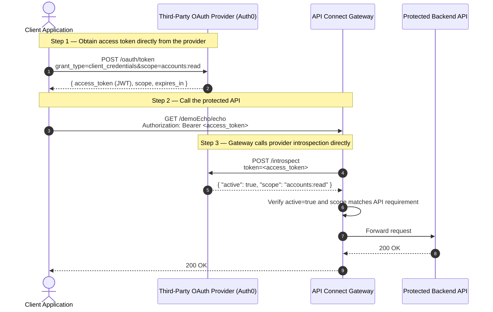
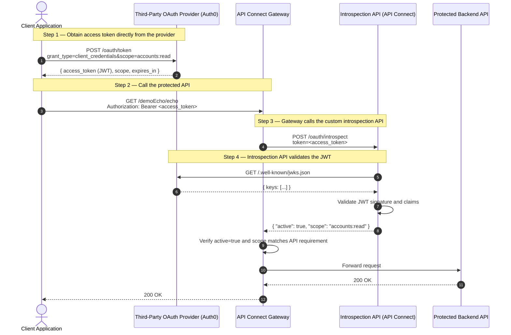

IBM API Connect can delegate OAuth token issuance and validation to an **external (third-party) OAuth 2.0 or OIDC provider**.  
This post walks through every step — from understanding the flow, to configuring the Third-Party OAuth Provider resource in API Manager, building a custom introspection API, protecting an API with that provider, and testing it end-to-end using Auth0 as the external provider.

> Looking for the **native** OAuth provider (APIC as the Authorization Server)?  
> See the companion post [Native OAuth Provider in IBM API Connect](/apic/APIC-Native-OAuth/).

The examples use the **Client Credentials** grant (called *Application* in API Connect) and **Auth0** as the external provider. Auth0 offers a free developer edition that is ideal for testing.

---

## OpenID Connect Support

As described on [openid.net](https://openid.net/connect/), OpenID Connect is a simple identity layer built on top of OAuth 2.0.

When a client application requests a token from an OIDC provider, it receives:
- an **access token** — used as a Bearer credential to call protected APIs, and
- an **id_token** — a signed JWT carrying claims about the authenticated user (name, email, etc.).

The access token is what the API Gateway validates. The id_token is for the consuming application only; the gateway does not inspect it.

If you configure API Connect with an external OIDC provider, the application obtains its access token directly from the OIDC provider and presents it to the gateway as a normal Bearer token. The gateway then calls the provider's introspection endpoint to validate it.

---

## OAuth Security Principle

When a **Third-Party OAuth Provider** is configured in API Connect, the gateway delegates token generation **and** validation to that provider.

Two deployment patterns are possible, depending on whether the third-party provider exposes a standard introspection endpoint.

### Pattern 1 — Direct introspection (provider exposes RFC 7662 endpoint)

The gateway calls the provider's introspection endpoint directly.



### Pattern 2 — Custom introspection API on API Connect (this post)

When the provider does not have a standard introspect endpoint, or when the token is a JWT you want to validate on the gateway, an introspection API is deployed on API Connect itself. The gateway calls that API instead of the provider directly.



This post covers **Pattern 2**: the introspection API is built and deployed within API Connect, and the Third-Party OAuth Provider resource points to it.

**Key points:**

1. The client obtains an access token **directly** from the third-party provider — not from API Connect.
2. The gateway calls the **configured introspection URL** (either the provider directly, or the custom API) to confirm the token is active and retrieve its scopes.
3. The introspection response **must** contain `"active": true` and a `scope` field. The gateway verifies the scopes match those declared on the API's security definition.
4. It is good practice to also require a **Client ID** (`X-IBM-Client-Id` header) on the API. This enables gateway-level rate limiting, plan subscriptions, and analytics per consuming application.

### Introspection request format

The gateway sends a POST to the configured introspection URL:

```http
POST /oauth/introspectURL HTTP/1.1
Host: <introspection-host>
Content-Type: application/x-www-form-urlencoded

token=<access_token>&token_type_hint=access_token&client_id=<subscriberClientId>&scope=<apiScope>
```

The introspection URL may be protected. API Connect can attach credentials via:
- **Basic auth** — client ID and secret are sent in the `Authorization` header.
- **Custom header** — a header name and value are configured on the OAuth resource.

A custom introspection API (described in the next section) is useful when:
- The provider does not expose a standard introspection endpoint.
- The access token is a JWT and you want to validate its signature on the gateway.
- You want to cache introspection results or apply additional business logic before returning scopes.

---

## API Connect Setup

### Setup Overview

Three resources must be configured in API Connect:

| Task | Who | Where |
|:---|:---|:---|
| Create the Third-Party OAuth Provider resource | Org admin | API Manager → Resources → OAuth Providers |
| Attach the provider to a catalog | Org/catalog admin | Catalog Settings → OAuth Providers |
| Add an OAuth security definition to the API | API developer | API definition (spec + policy sequence) |

### Implement a Custom Introspection API

> Skip this section if your third-party provider exposes a standards-compliant introspection endpoint (RFC 7662) that the gateway can call directly. Configure that URL in the OAuth resource and move on.

This section explains how to build a custom introspection API inside API Connect when you need to validate a JWT token yourself, proxy a non-standard introspect endpoint, or add caching/extra validation logic.

The introspection API must:
1. Accept a POST with a form-encoded body containing `token=<access_token>`.
2. Validate the token (e.g. verify JWT signature using the provider's JWKS).
3. Return a JSON body with at minimum `{ "active": true/false, "scope": "<space-separated scopes>" }`.

The example below extracts the JWT from the request, fetches the JWKS from Auth0, validates the signature, and builds the response from the JWT claims.

The complete project files for this introspection API are available in [`assets/files/apic/apic-oauth-thirdParty/TPP/`](/assets/files/apic/apic-oauth-thirdParty/TPP/).

| File | Kind | Purpose |
|:---|:---|:---|
| [`oauth-token-introspection.yaml`](/assets/files/apic/apic-oauth-thirdParty/TPP/oauth-token-introspection.yaml) | API | API Studio API asset |
| [`oauth-token-introspection-spec.yml`](/assets/files/apic/apic-oauth-thirdParty/TPP/oauth-token-introspection-spec.yml) | OpenAPI 2.0 | Swagger spec — POST /oauth/introspect |
| [`assembly-oauth-token-introspection.yml`](/assets/files/apic/apic-oauth-thirdParty/TPP/assembly-oauth-token-introspection.yml) | DataPowerAssembly | JWT validation logic |
| [`cors-oauth-token-introspection.yml`](/assets/files/apic/apic-oauth-thirdParty/TPP/cors-oauth-token-introspection.yml) | CORS | CORS settings |
| [`properties-oauth-token-introspection.yml`](/assets/files/apic/apic-oauth-thirdParty/TPP/properties-oauth-token-introspection.yml) | Properties | `jwks-url` property |

The introspection assembly logic (`assembly-oauth-token-introspection.yml`):

```yaml
kind: DataPowerAssembly
apiVersion: api.ibm.com/v1
metadata:
  name: assembly-oauth-token-introspection
  namespace: TPP
  version: 1.0.0
spec:
  x-ibm-configuration:
    security: []
    securityDefinitions: {}
    cors:
      enabled: true
    gateway: datapower-api-gateway
    type: rest
    phase: realized
    enforced: true
    testable: true
    properties:
      jwks-url:
        value: https://dev-qcqhr0repsv7nxpg.eu.auth0.com/.well-known/jwks.json
        description: JWKS endpoint for JWT signature validation
        encoded: false
    assembly:
      execute:
        # Step 1: extract the token from the form-encoded body
        - gatewayscript:
            version: 2.0.0
            title: extract-token
            source: |
              context.request.body.readAsBuffer(function(error, buffer) {
                if (error) { context.message.statusCode = '500'; return; }
                if (buffer) {
                  var bodyStr = buffer.toString();
                  bodyStr.split('&').forEach(function(pair) {
                    var kv = pair.split('=');
                    if (kv[0] === 'token') {
                      context.set('reqat', kv[1]);
                    }
                  });
                } else {
                  context.message.statusCode = '500';
                }
              });
        # Step 2: fetch the JWKS (cached 900 s)
        - invoke:
            title: fetch-jwks
            timeout: 60
            verb: GET
            cache-response: protocol
            cache-ttl: 900
            version: 2.0.0
            target-url: $(api.properties.jwks-url)
            output: rsa256-key
            header-control:
              type: blacklist
              values: []
            parameter-control:
              type: blacklist
              values: []
            tls-profile: tls-client-profile-catalog-default:1.0.0
            backend-type: json
        # Step 3: pick the first JWK
        - gatewayscript:
            title: pick-jwk
            version: 2.0.0
            source: |-
              var rsa256Key = JSON.parse(context.get('rsa256-key.body'));
              context.set('jwk-key', rsa256Key.keys[0]);
        # Step 4: validate JWT signature
        - jwt-validate:
            version: 2.0.0
            title: at-jwt-validate
            jwt: reqat
            output-claims: decoded.claims
            jws-jwk: jwk-key
            description: Validate the provided JWT token
        # Step 5: build the introspection response
        - gatewayscript:
            title: build-response
            version: 2.0.0
            source: |
              if (context.get('decoded.claims')) {
                var decClaims = context.get('decoded.claims');
                var response = {
                  active: true,
                  token_type: 'bearer',
                  scope: decClaims.scope
                };
                context.set('message.body', response);
                context.message.header.set('content-type','application/json');
                context.message.header.remove('authorization');
                context.set('message.status.code', 200);
              } else {
                context.set('message.body', { active: false });
                context.message.header.set('content-type','application/json');
                context.message.header.remove('authorization');
                context.set('message.status.code', 200);
              }
      catch: []
    application-authentication:
      certificate: false
    activity-log:
      success-content: payload
      error-content: activity
      enabled: true
    buffering: true
```

To test the introspection API directly:

```shell
curl -X POST \
  "https://<gateway-host>/<org>/<catalog>/oauth/introspect" \
  -H "Content-Type: application/x-www-form-urlencoded" \
  --data-urlencode "token=<ACCESS_TOKEN>" \
  --data-urlencode "token_type_hint=access_token"
```

Note the **deployed URL** of this introspection API — you will configure it in the Third-Party OAuth Provider resource.

### Third-Party OAuth Provider Resource

The OAuth provider resource is created once by the organization administrator and reused across multiple API definitions.

**Prerequisites:**
- The URLs for the external OAuth provider (authorize, token, introspection endpoints).
- Client credentials to call the introspection endpoint (if protected).
- The set of scopes you want to permit.

**UI steps:**

1. Log into **API Manager**.
2. Navigate to **Resources → OAuth Providers**.
3. Click **Add → Third-Party OAuth Provider**.
4. Fill in **Basic settings**:

   | Field | Example value |
   |:---|:---|
   | Title | `TPP_Auth0_DP` |
   | Name | `tpp_auth0_dp` *(auto-filled)* |
   | Gateway type | `DataPower® API Gateway` |
   | Grant types | `Application` (Client Credentials) and/or `Access Code` (Authorization Code) |
   | Scope 1 | `accounts:read` — Read access to accounts |
   | Scope 2 | `accounts:write` — Create and update accounts |

5. Fill in **Third-Party Configuration**:

   | Field | Example value |
   |:---|:---|
   | Authorization URL | `https://dev-qcqhr0repsv7nxpg.eu.auth0.com/oauth/authorize` |
   | Token URL | `https://dev-qcqhr0repsv7nxpg.eu.auth0.com/oauth/token` |
   | Introspection URL | Your deployed introspection API URL (or the provider's standard endpoint) |
   | Token validation requirement | `active` |
   | TLS client profile | Select a catalog TLS profile for the introspection call |

6. If the introspection endpoint is protected with basic auth, configure credentials in the **Security** section or pass them via a custom header.

7. Click **Save**.


> **Scopes** — only scopes listed here can be referenced in an API security definition. Attempting to deploy an API with an unlisted scope causes a deployment error. Developers can use any subset of these scopes.

> **Advanced scope** — an optional external URL can be called after introspection to override or refine the granted scopes. Useful for adding business-level authorization logic outside the token.

> **TLS profile** — since the introspection endpoint is HTTPS, a TLS profile must be selected. The default catalog TLS profile (`tls-client-profile-catalog-default`) is usually sufficient.

**CLI alternative** — the resource can also be managed via the APIC toolkit CLI (requires login):

```shell
# export the existing resource definition to use as a template
apic oauth-providers:get tpp_auth0_dp --org <provider-org> --server <mgmt-endpoint>

# create or update a resource from a JSON definition
apic oauth-providers:create --org <provider-org> --server <mgmt-endpoint> TPP-resource.json
```

The [`TPP-resource.json`](/assets/files/apic/apic-oauth-thirdParty/TPP-resource.json) file in the repository shows the full resource definition used in this example.

### Attach the Provider to a Catalog

The OAuth provider must be attached to every catalog in which APIs secured with it will be deployed.

**UI steps:**

1. Navigate to **Manage → Catalogs** and open the target catalog (e.g. **Sandbox**).
2. Go to **Catalog Settings → OAuth Providers**.
3. Click **Edit** and select `tpp_auth0_dp`.
4. Save.

```
API Manager → Manage → <Catalog> → Settings → OAuth Providers
```

> If you are using the embedded API Studio toolkit, the API is deployed to the **Sandbox** catalog — make sure the provider is attached there.

---

## API Studio Project — Echo API

The Echo API is a minimal API that:
- is protected by the Third-Party OAuth Provider (`tpp_auth0_dp`),
- requires the `accounts:read` scope on the `GET /echo` operation,
- returns a simple JSON response (no real backend — the assembly builds the response).

All project files live in [`assets/files/apic/apic-oauth-thirdParty/EchoApp/`](/assets/files/apic/apic-oauth-thirdParty/EchoApp/).

### File Overview

| File | Kind | Purpose |
|:---|:---|:---|
| [`DemoEchoApp.yaml`](/assets/files/apic/apic-oauth-thirdParty/EchoApp/DemoEchoApp.yaml) | API | API Studio API asset |
| [`demoechoapp-spec.yml`](/assets/files/apic/apic-oauth-thirdParty/EchoApp/demoechoapp-spec.yml) | OpenAPI 3.0 | API specification with OAuth security scheme |
| [`polseq-demo-dp.yml`](/assets/files/apic/apic-oauth-thirdParty/EchoApp/polseq-demo-dp.yml) | DataPowerAssembly | DataPower gateway assembly |

### OpenAPI Spec — Security Scheme

The critical part of [`demoechoapp-spec.yml`](/assets/files/apic/apic-oauth-thirdParty/EchoApp/demoechoapp-spec.yml):

```yaml
components:
  securitySchemes:
    tppoauth:
      type: oauth2
      x-ibm-oauth-provider: tpp_auth0_dp    # must match the provider name in API Manager
      flows:
        clientCredentials:
          tokenUrl: https://dev-qcqhr0repsv7nxpg.eu.auth0.com/oauth/token
          scopes:
            accounts:read: Read access to accounts
            accounts:write: Create and update accounts
```

> The value of `x-ibm-oauth-provider` must match the **name** (not title) of the Third-Party OAuth Provider resource created in API Manager.  
> The provider must be attached to the catalog where the API is deployed, or the deployment will fail.

The security requirement on the operation:

```yaml
paths:
  /echo:
    get:
      security:
        - tppoauth:
            - accounts:read
```

### DataPower Assembly

[`polseq-demo-dp.yml`](/assets/files/apic/apic-oauth-thirdParty/EchoApp/polseq-demo-dp.yml) is a `DataPowerAssembly` kind.

The gateway handles OAuth enforcement automatically based on the security scheme in the OpenAPI spec — no explicit OAuth policy is needed in the assembly. The assembly simply builds a response:

```yaml
- gatewayscript:
    version: 2.0.0
    title: gatewayscript
    source: |
      var response = { "status": "ok" };
      context.set('message.body', response);
```

### Adding OAuth to an Existing API via the UI

You can add a Third-Party OAuth security scheme to an existing API using the API Studio form instead of editing YAML directly.

<mark>The API must use a **DataPower API Gateway** policy sequence. Third-party OAuth Provider is only supported with this gateway type and API Studio enforces this constraint.</mark>

Steps:

1. Open your API in **API Studio** and click **Components** in the Outline view.
2. Scroll down to **Security Schemes** and click **Add security scheme**.
3. Provide a key name (e.g. `tppoauth`) and select **oauth2**. Click **Add**.
4. In the scheme editor, select **Connect to API Manager** and provide your API Manager URL, organisation, and catalog where the Third-Party OAuth Provider is configured.

   > You must be connected to an API Manager instance for API Studio to load the available OAuth providers.

5. Select the provider (`tpp_auth0_dp`) — the flows, token URL, and scopes are loaded automatically from the provider configuration.
6. Apply the security scheme to the desired operations and select the required scopes.

---

## Testing the Configuration

### Step 1 — Subscribe to the API Product

Before calling the API you need a **Client ID** (and optionally a **Client Secret**) from a subscription.

**Via the Developer Portal:**

1. Open the **Developer Portal**.
2. Navigate to **Asset Gallery** and select your API.
3. Select **API Products** and click on the **Product**.
4. Under **Plans**, click **Subscribe**.
5. Create a new application or select an existing one.
6. Note the **Client ID** and **Client Secret**.

**Via the API Manager (for testing):**

Go to **Manage → Catalogs → Sandbox → Subscriptions** and create a subscription directly from the UI.

### Step 2 — Obtain an Access Token from the Third-Party Provider

With a third-party provider, the access token is obtained **directly from that provider** — not from API Connect.

Using **Auth0** with Client Credentials:

```shell
curl --request POST \
  --url https://dev-qcqhr0repsv7nxpg.eu.auth0.com/oauth/token \
  --header 'Content-Type: application/json' \
  --data '{
    "client_id":     "<auth0-app-client-id>",
    "client_secret": "<auth0-app-client-secret>",
    "audience":      "https://apic-demo",
    "grant_type":    "client_credentials",
    "scope":         "accounts:read"
  }'
```

Expected response:

```json
{
  "access_token": "eyJ...",
  "scope":        "accounts:read",
  "expires_in":   86400,
  "token_type":   "Bearer"
}
```

The access token is a JWT. Decoded, it looks like:

```json
{
  "iss": "https://dev-qcqhr0repsv7nxpg.eu.auth0.com/",
  "sub": "3krnpuhn4K3zcKEX26evvQ3m1kK2VrLC@clients",
  "aud": "https://apic-demo",
  "iat": 1791977624,
  "exp": 1792064024,
  "scope": "accounts:read",
  "gty": "client-credentials",
  "azp": "3krnpuhn4K3zcKEX26evvQ3m1kK2VrLC"
}
```

Tip — extract just the token with `jq`:

```shell
TOKEN=$(curl -s --request POST \
  --url https://dev-qcqhr0repsv7nxpg.eu.auth0.com/oauth/token \
  --header 'Content-Type: application/json' \
  --data '{"client_id":"<id>","client_secret":"<secret>","audience":"https://apic-demo","grant_type":"client_credentials","scope":"accounts:read"}' \
  | jq -r '.access_token')
```

### Step 3 — Call the Protected API

Use the Bearer token from Step 2 and the Client ID from Step 1:

```shell
curl -X GET \
  "https://<gateway-host>/<org>/<catalog>/demoEcho/echo" \
  -H "Authorization: Bearer ${TOKEN}" \
  -H "X-IBM-Client-Id: <client-id>" \
  -H "Accept: application/json"
```

Expected response:

```json
{ "status": "ok" }
```

If the token is invalid or the scope is insufficient the gateway returns HTTP 401.  
If the Client ID is not subscribed to the product the gateway returns HTTP 401.

---

## Configure Auth0 as the OAuth Authorization Server

[Auth0 developer edition](https://developer.auth0.com/resources/labs/tools) provides a free hosted instance suitable for testing.

### Client Credentials (Application grant)

1. Log into your Auth0 tenant. A **Default Application** is created automatically.  
   

2. In the application **Settings**, copy the **Client ID** and **Client Secret**.

3. Create an **API** that represents the resource server:
   - Go to **Applications → APIs** and click **Create API**.
   - Set the **Identifier** (audience) to something like `https://apic-demo`.  
   

4. Under the API's **Permissions** tab, add the scopes you need (`accounts:read`, `accounts:write`):  
   

5. Under the API's **Machine to Machine Applications** tab, authorise the **Default App** and grant the required permissions:  
   
   

6. Test the token endpoint directly from the Auth0 **Test** tab:  
   

The **JWKS endpoint** for signature validation is:

```
https://<your-tenant>.eu.auth0.com/.well-known/jwks.json
```

e.g. `https://dev-qcqhr0repsv7nxpg.eu.auth0.com/.well-known/jwks.json`

Configure this URL as the `jwks-url` property in the introspection API assembly.

### Authorization Code grant

To use the Authorization Code flow with Auth0:

1. Create a **Regular Web Application** (not Machine-to-Machine).
2. In the application **Settings → Application URIs**, set:
   - **Application Login URI**: `https://example.com`
   - **Allowed Callback URIs**: `https://example.com`  
   

3. Create a user: **User Management → Users → Create User**.  
   Use **Username-Password-Authentication** as the connection.

4. Assign scopes to the user: open the user, go to **Permissions**, select the application, click **Assign Permission**, select `accounts:read` and `accounts:write`, and click **Add Permissions**:  
   

5. Redirect the user to Auth0's authorize endpoint to get a code (open in a browser):

   ```
   https://dev-qcqhr0repsv7nxpg.eu.auth0.com/oauth/authorize?
     response_type=code
     &client_id=<AppClientId>
     &redirect_uri=https://example.com
     &audience=https://apic-demo
     &scope=openid%20profile%20accounts:read
     &state=123456
   ```

   After login, the browser is redirected to `https://example.com?code=CC-TWglx6....`. Copy the `code` value.

6. Exchange the code for tokens:

   ```shell
   curl --request POST \
     "https://dev-qcqhr0repsv7nxpg.eu.auth0.com/oauth/token" \
     --header "Content-Type: application/x-www-form-urlencoded" \
     --data-urlencode "grant_type=authorization_code" \
     --data-urlencode "client_id=<AppClientId>" \
     --data-urlencode "client_secret=<AppClientSecret>" \
     --data-urlencode "code=CC-TWglx6...." \
     --data-urlencode "redirect_uri=https://example.com"
   ```

   Expected response:

   ```json
   {
     "access_token": "eyJ...FMix8tF185-blLACI87lqUCrBw",
     "id_token":     "eyJhbGciOiJ...268iU5MUoiINdoDTVVweTA",
     "scope":        "openid profile",
     "expires_in":   86400,
     "token_type":   "Bearer"
   }
   ```

   The access token payload:

   ```json
   {
     "iss": "https://dev-qcqhr0repsv7nxpg.eu.auth0.com/",
     "sub": "auth0|6ad08dc1c060a910c9994ce2",
     "aud": ["https://apic-demo", "https://dev-qcqhr0repsv7nxpg.eu.auth0.com/userinfo"],
     "scope": "openid profile",
     "azp": "yoRwWfOfBPx7SRXGOdcj89AyZ99Hr5AD"
   }
   ```

   The id token payload (OIDC user claims):

   ```json
   {
     "nickname":   "prichelle.pub",
     "name":       "prichelle.pub@gmail.com",
     "email":      "prichelle.pub@gmail.com",
     "sub":        "auth0|6ad08dc1c060a910c9994ce2",
     "iss":        "https://dev-qcqhr0repsv7nxpg.eu.auth0.com/",
     "aud":        "yoRwWfOfBPx7SRXAD"
   }
   ```

> **Note:** Auth0 does not support CORS on its token endpoint. This means the Developer Portal's built-in OAuth test tool cannot fetch a token from Auth0 directly. Obtain the token via `curl` or a tool like [Bruno](https://www.usebruno.com/) and paste it into the Portal test form.

---

## Resources

- [IBM API Connect — OAuth introspection (Knowledge Center)](https://www.ibm.com/support/knowledgecenter/SSMNED_v10/com.ibm.apic.apionprem.doc/oauth_introspection.html)
- [IBM API Connect — Implementing OAuth security](https://www.ibm.com/support/knowledgecenter/en/SSMNED_v10/com.ibm.apic.apionprem.doc/tutorial_apionprem_oauth_passgrant.html)
- [Manage your APIs with API Connect — Using OAuth to protect your API](https://github.com/ADesprets/bluemix-labs/blob/master/Lab%20API%20-%20Manage%20your%20APIs%20with%20API%20Connect/README-V10.md#step-12---using-oauth-to-protect-your-api)
- [Auth0 Developer Tools](https://developer.auth0.com/resources/labs/tools)
- [Auth0 Getting Started](https://auth0.com/docs/get-started)
- [RFC 7662 — OAuth 2.0 Token Introspection](https://tools.ietf.org/html/rfc7662)
- [RFC 8414 — OAuth 2.0 Authorization Server Metadata](https://tools.ietf.org/html/rfc8414)
- [Companion post — Native OAuth Provider in IBM API Connect](/apic/APIC-Native-OAuth/)
- [APIC v10 tutorials — OAuth introspect proxy (GitHub)](https://github.com/prichelle/apic-v10-tutorials/blob/main/oauth/oauth-api-introspect-proxy.yaml)
