When developing integration flows in **IBM webMethods Integration (IWHI / webMethods.io SaaS)**, you frequently need to expose a Flow Service to external or internal consumers. Depending on your consumers and architecture, you may need to expose the same integration flow as:
- A **REST API** with JSON request/response payloads.
- A **SOAP Web Service (WSD)** with SOAP 1.1 or SOAP 1.2 XML envelopes and WSDL definitions.

While both interfaces can execute the exact same underlying Flow Service, their **runtime URLs, authentication models, and header requirements** differ significantly in the SaaS environment.

This post covers:
1. Exposing a Flow Service as a REST API and as a SOAP Web Service (Provider WSD).
2. How to find and understand the runtime Endpoint URLs.
3. How to configure authentication (OAuth 2.0 Scopes for REST vs. Instance API Keys for SOAP).
4. How to call each service using **cURL** and **Bruno**.
5. Key gotchas (SOAP 1.2 Content-Type vs SOAP 1.1 headers, 401/500 errors).
6. How to invoke the SOAP service backend securely from an **IBM API Connect (DataPower Gateway)** assembly policy.

---

## Architecture Overview

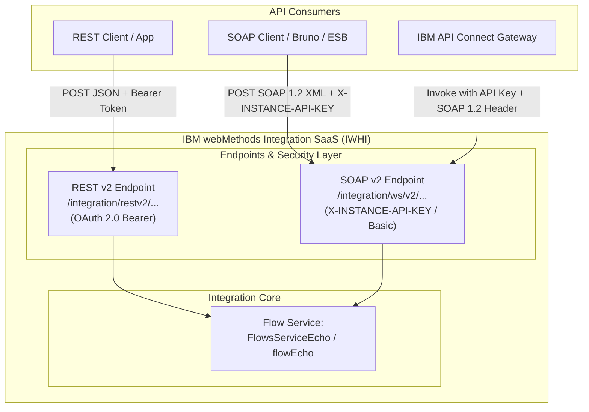

---

## 1. Exposing a Flow Service

Suppose we have a simple Flow Service called `FlowsServiceEcho` (or `flowEcho`) under project ID `fl6dc44d25a8`:
- **Input Document**: `Input` containing a string field `Message`.
- **Output Document**: `Output` containing a string field `echo`.

### Exposing as a REST API
1. In the webMethods Integration navigation, open your Project and navigate to **APIs** &rarr; **REST APIs**.
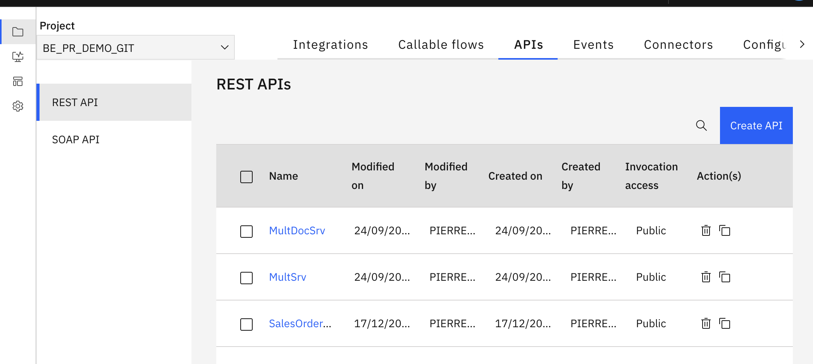. 
2. Click **Create REST API**.  
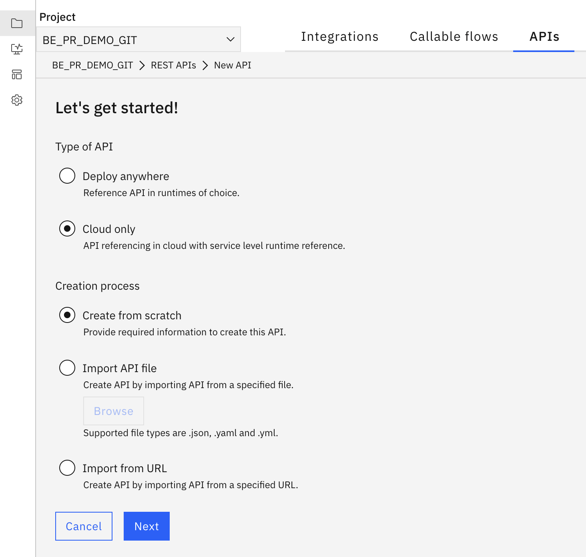.  
Select cloud or deploy anywhere based on the Wm FlowService type that you have created and want to expose.  
Select "create from scratch".  
3. provide a name, and for the access network choose **public**.   
4. On the **Resources and Methods** click on **add resource**.  
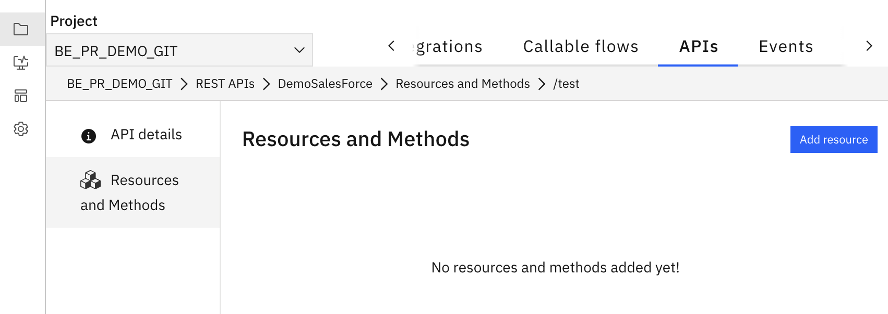. 
5. Provide a **path** and select the operation to expose.  
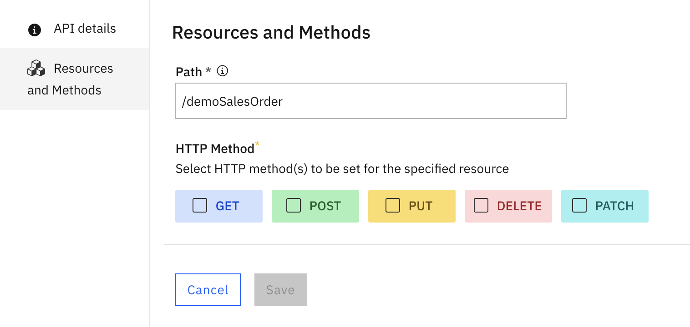. 
6. Choose your **flow service** and **done**.  
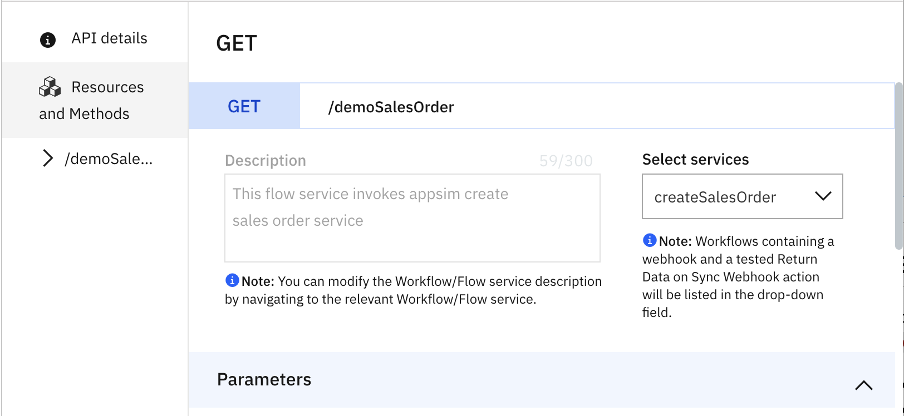.  
7. **save**

### Exposing as a SOAP API (Provider WSD)
1. In your Project, go to **APIs** &rarr; **SOAP APIs**.
2. Click **Create API** 
3. Choose **From Scratch**.
4. Set the service name (e.g., `EchoTestSoap`)
- select **SOAP 1.2** (or SOAP 1.1)  
- For the access network choose **public**.  
- Select the flow service that you would like to expose
- Document/Literal.   
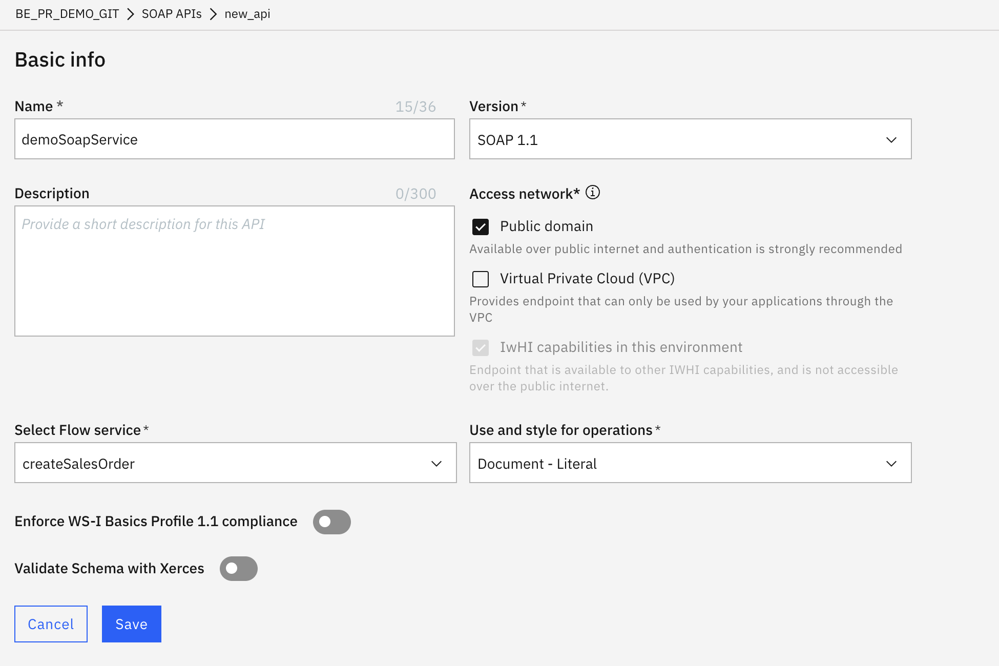. 


---

## 2. Finding the Runtime URLs

### REST Endpoint URL
In webMethods SaaS, REST endpoints follow a stage-scoped path:

```text
https://<TENANT-HOST>/integration/restv2/<STAGE>/<PROJECT_ID>/<REST_API_NAME>/<RESOURCE_PATH>
```

**Example:**
```text
https://dev7963962.a-fra-c1.int.ipaas.automation.ibm.com/integration/restv2/development/fl6dc44d25a8/FlowsServiceEcho/echo
```

### SOAP Endpoint URL
Open the downloaded WSDL file in an editor and scroll to the `<wsdl:service>` block at the bottom:

```xml
<wsdl:service name="EchoTestSoap">
  <wsdl:port name="EchoTestSoap_Port" binding="tns:EchoTestSoap_Binder">
    <soap12:address location="https://dev7963962.a-fra-c1.int.ipaas.automation.ibm.com/integration/ws/v2/fl6dc44d25a8/EchoTestSoap/EchoTestSoap_Port"/>
  </wsdl:port>
</wsdl:service>
```

The URL in `soap12:address location` is the target SOAP endpoint:
```text
https://dev7963962.a-fra-c1.int.ipaas.automation.ibm.com/integration/ws/v2/fl6dc44d25a8/EchoTestSoap/EchoTestSoap_Port
```

---

## 3. Configuring Authentication & Credentials

Understanding the security separation between REST and SOAP in IWHI SaaS is critical:

| Feature | REST API | SOAP Web Service |
| :--- | :--- | :--- |
| **Authentication Type** | OAuth 2.0 Bearer Token | `X-INSTANCE-API-KEY` or HTTP Basic Auth |
| **Scope Management UI** | Under **Settings &rarr; OAuth &rarr; Scopes** | Directly authenticated by Runtime Key / Basic User |
| **Header Used** | `Authorization: Bearer <token>` | `X-INSTANCE-API-KEY: <key>` |

### A. Configuring OAuth 2.0 for REST APIs
1. In webMethods Integration, navigate to **Settings** &rarr; **OAuth 2.0** &rarr; **Scope Management** &rarr; 
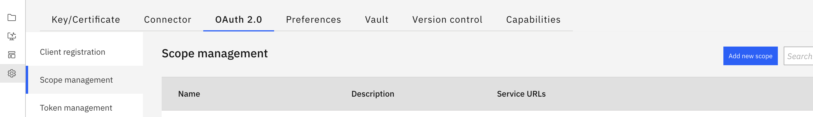
2. Click **Add new Scope**, provide a name (e.g. `postEchoFs`):
   - Select your REST API resource path: `/integration/restv2/development/fl6dc44d25a8/FlowsServiceEcho/`.   
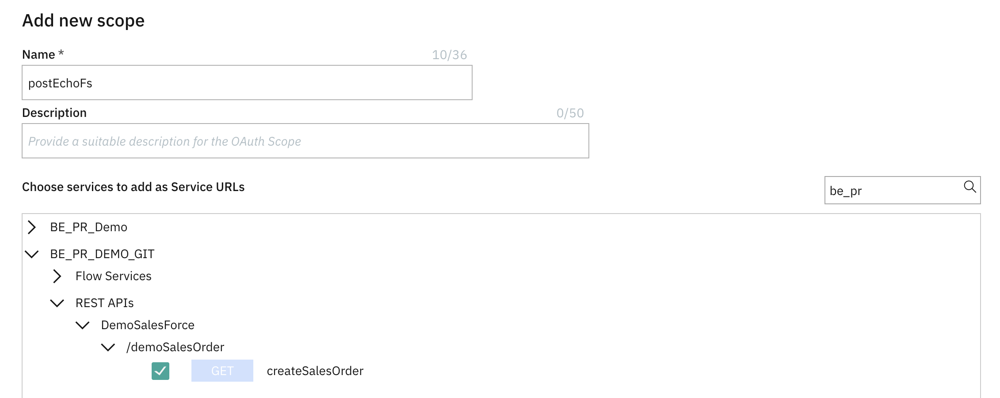.  

3. Under **Applications**, register a client application  
- A version 
- type: Confidential. 
- redirect url: for example: **https://example.com***. 
- grants: client credential grants.  
- set the appropriate expiration.   
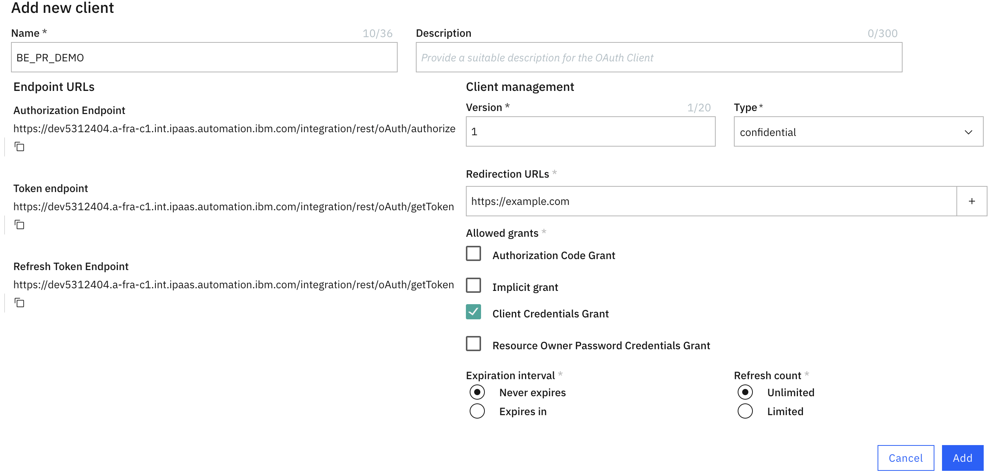.  

4. In the client registration list, identify the one that you created and select to add a new scope.   
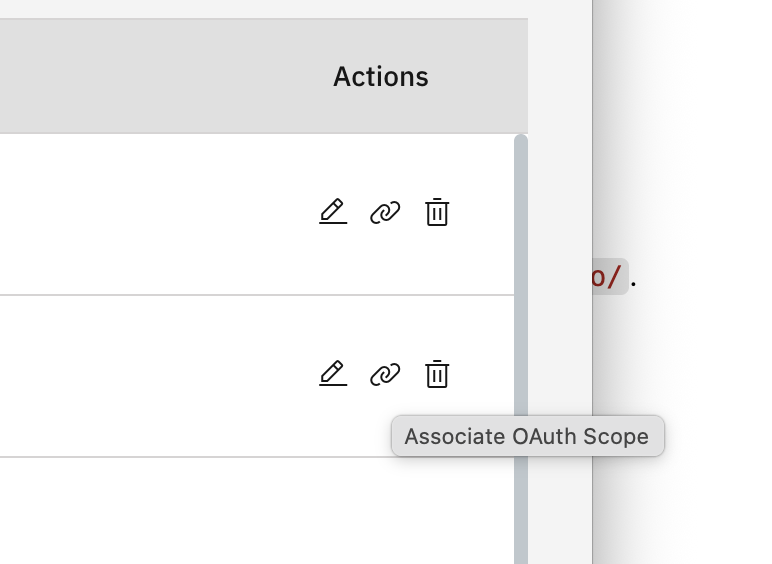. 
5. Select **associate new scope** and select the scope that you created previously.  
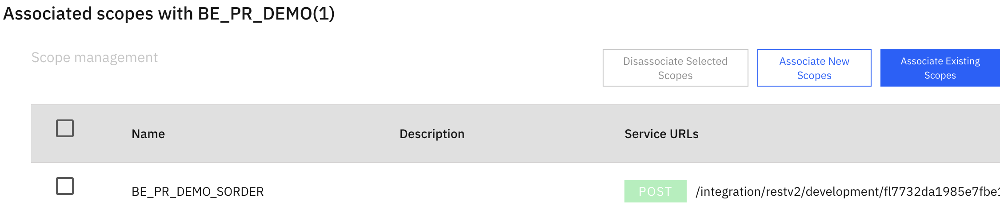.  
7. To get the client Id and Secret, edit your client registration.   
6. Request an OAuth token using the Client Credentials grant:
   ```bash
   curl -X POST 'https://dev762.a-fra-c1.int.ipaas.automation.ibm.com/integration/oauth/token' \
     -H 'Content-Type: application/x-www-form-urlencoded' \
     -d 'grant_type=client_credentials&client_id=<CLIENT_ID>&client_secret=<CLIENT_SECRET>&scope=postEchoFs'
   ```
   This returns an `access_token`.

### B. Configuring Instance API Key for SOAP Web Services.  

Because the native SOAP runtime (`/integration/ws/v2/...`) does not participate in the REST OAuth scope mapping UI, you need to get an API Keys.  
This API Keys can be created as follows (Note that you need proper rights to be able to access it).
1. accessing the **manage environments** &rarr; **IBM SaaS Console**.    
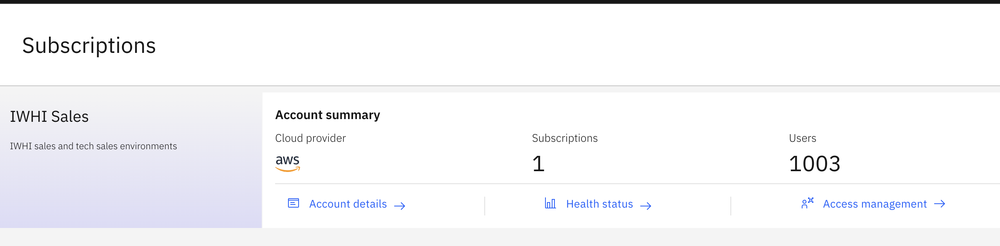.  
2. Navigate to **Access Management** &rarr; **API Keys** (or **Instance Keys**).
3. Generate an **Key**.
3. Copy the resulting key string (e.g. `azI6ZWMzNDdiNTct...`).
4. Pass this key in incoming SOAP requests via the `X-INSTANCE-API-KEY` HTTP header.

---

## 4. Testing the Calls

### Calling the REST API

Execute the following `cURL` command passing the OAuth bearer token:

```bash
curl -i -X POST 'https://dev62.a-fra-c1.int.ipaas.automation.ibm.com/integration/restv2/development/fl6dc44d25a8/FlowsServiceEcho/echo' \
  -H 'Authorization: Bearer <bearer token>' \
  -H 'Accept: application/json' \
  -H 'Content-Type: application/json' \
  -d '{"Message": "Hello from REST"}'
```

**Response (HTTP 200 OK):**
```json
HTTP/2 200 
content-type: application/json; charset=UTF-8

{
  "Output": {
    "echo": "Hello from REST"
  }
}
```

---

### Calling the SOAP 1.2 Web Service

For a **SOAP 1.2** service, the SOAP action must be included inside the `Content-Type` header parameter rather than as a standalone `SOAPAction` header:

```bash
curl -i -X POST 'https://dev792.a-fra-c1.int.ipaas.automation.ibm.com/integration/ws/v2/fa8/EchoTestSoap/EchoTestSoap_Port' \
  -H 'Content-Type: application/soap+xml; charset=utf-8; action="EchoTestSoap_Binder_flowEcho"' \
  -H 'X-INSTANCE-API-KEY: <YOUR-API-KEY>' \
  -d '<?xml version="1.0" encoding="utf-8"?>
<soap:Envelope xmlns:soap="http://www.w3.org/2003/05/soap-envelope" xmlns:ech="https://dev796.a-fra-c1.int.ipaas.automation.ibm.com/integration/wsd/EchoTestSoap">
  <soap:Header/>
  <soap:Body>
    <ech:flowEcho>
      <Input>
        <Message>Hello World</Message>
      </Input>
    </ech:flowEcho>
  </soap:Body>
</soap:Envelope>'
```

**Response (HTTP 200 OK):**
```xml
HTTP/2 200 
content-type: application/soap+xml; charset=utf-8; action="https://dev79.a-fra-c1.int.ipaas.automation.ibm.com/integration/wsd/EchoTestSoap/EchoTestSoap_PortType/flowEchoResponse"

<?xml version='1.0' encoding='utf-8'?>
<soapenv:Envelope xmlns:soapenv="http://www.w3.org/2003/05/soap-envelope">
  <soapenv:Body>
    <ser-root:flowEchoResponse xmlns:ser-root="https://dev7.a-fra-c1.int.ipaas.automation.ibm.com/integration/wsd/EchoTestSoap" xmlns:xsi="http://www.w3.org/2001/XMLSchema-instance">
      <Output>
        <echo>Hello World</echo>
      </Output>
    </ser-root:flowEchoResponse>
  </soapenv:Body>
</soapenv:Envelope>
```

---

## 5. Common Pitfalls & Troubleshooting

### Pitfall 1: SOAP 1.1 vs SOAP 1.2 Headers (500 Error)
If you send SOAP 1.1 headers (`Content-Type: text/xml` + `SOAPAction: ...`) to a SOAP 1.2 service, webMethods returns:
```xml
<soapenv:Fault>
  <faultcode>soapenv:Server</faultcode>
  <faultstring>Transport level information does not match with SOAP Message namespace URI</faultstring>
</soapenv:Fault>
```
**Fix**: Use `Content-Type: application/soap+xml; charset=utf-8; action="<SOAP_ACTION>"`.

### Pitfall 2: Bruno Configuration
In Bruno:
- **Headers**: Set `Content-Type` to `application/soap+xml; charset=utf-8; action="EchoTestSoap_Binder_flowEcho"`.
- **Auth**: Choose `API Key` &rarr; Key: `X-INSTANCE-API-KEY` &rarr; Placement: `Header`.
- Remove standalone `SOAPAction` or `action` headers.

---

## 6. Calling the Service from IBM API Connect (DataPower Gateway)

When using **IBM API Connect** (v10 / DataPower Gateway) to orchestrate or proxy calls to this webMethods SOAP backend, configure a `set-variable` policy before the `invoke` policy:

```yaml
                  - set-variable:
                      version: 2.0.0
                      title: Set Headers for webMethods SOAP
                      actions:
                        - set: message.headers.X-INSTANCE-API-KEY
                          value: azI6ZWMzTVU9
                          type: string
                        - set: message.headers.Content-Type
                          value: 'application/soap+xml; charset=utf-8; action="EchoTestSoap_Binder_flowEcho"'
                          type: string
                  - invoke:
                      title: 'flowEcho: invoke'
                      target-url: https://dev79.a-fra-c1.int.ipaas.automation.ibm.com/integration/ws/v2/fl/EchoTestSoap/EchoTestSoap_Port
                      verb: POST
                      timeout: 60
                      version: 2.0.0
                      cache-response: protocol
                      cache-ttl: 900
                      stop-on-error:
                        - ConnectionError
                        - OperationError
                      header-control:
                        type: blocklist
                        values: []
                      parameter-control:
                        type: blocklist
                        values: []
```

---

## Summary

- **REST APIs in IWHI SaaS** are best suited for modern web/mobile apps and participate in the built-in **OAuth 2.0 Scope** model.
- **SOAP Services (WSD)** are directly hosted on the integration engine (`/integration/ws/v2/...`) and authenticate via **`X-INSTANCE-API-KEY`** or Basic Auth.
- For SOAP 1.2, ensure your client sends `Content-Type: application/soap+xml; charset=utf-8; action="..."` to avoid SOAP transport namespace mismatch faults.
