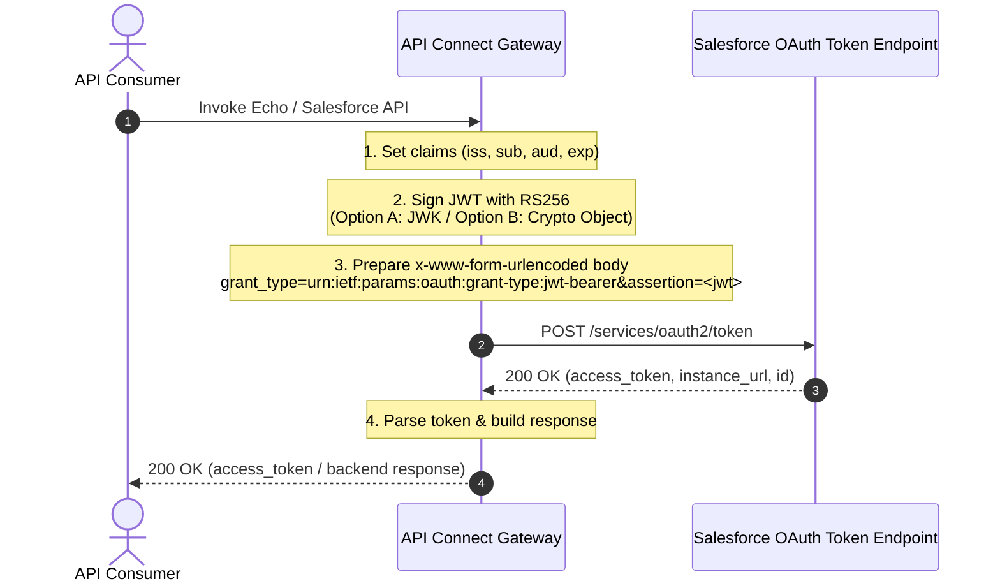

When integrating enterprise APIs with third-party platforms such as **Salesforce**, **Google Cloud**, or **Azure**, backend services frequently require authentication via the **OAuth 2.0 JWT Bearer Token Flow** ([RFC 7523](https://datatracker.ietf.org/doc/html/rfc7523)). Instead of managing user credentials or client secrets directly within client applications, the **IBM API Connect (DataPower API Gateway)** can act as a trusted integration layer that generates, signs, and exchanges JWT assertions for access tokens on the fly.

IBM API Connect provides the `jwt-generate` policy within its assembly engine. 
One of the most important aspects of JWT generation is the digital signature. In the OAuth 2.0 JWT Bearer flow, the JWT assertion must be signed using an asymmetric algorithm such as **RS256** (RSA with SHA-256).

The signature serves two purposes:

- It guarantees the integrity of the JWT and ensures that the claims have not been modified after generation.
- It allows the target platform to verify that the JWT was signed using the private key associated with a trusted public certificate.

To achieve this, a public/private key pair is required:

- The **private key** remains under the control of API Connect and is used to sign the JWT.
- The **public certificate** is shared with the target platform (Salesforce in this example), allowing it to validate signatures generated with the corresponding private key.

IBM API Connect supports multiple mechanisms for providing the signing key to the `jwt-generate` policy. This article focuses on the two most commonly used approaches:

- **Inline JWK (JSON Web Key)** stored in API Connect properties and referenced directly from the assembly.
- **DataPower Crypto Object** backed by an API Connect Keystore and TLS Client Profile.

Both approaches produce equivalent signed JWT assertions. The main difference lies in how the private key is managed and governed. 

This post walks through the complete end-to-end setup for both approaches, using the **Salesforce OAuth 2.0 JWT Bearer Flow** as our real-world example.

---

## Architecture and Flow Overview

In the Salesforce JWT Bearer flow, the client calls the API Connect Gateway.  
The gateway constructs a signed JWT assertion containing standard claims (`iss`, `sub`, `aud`, `exp`), sends a POST request to Salesforce's token endpoint (`https://login.salesforce.com/services/oauth2/token`), and retrieves the access token.



### JWT Generation

API Connect provides the `jwt-generate` policy to create and optionally sign JSON Web Tokens during assembly execution.

The policy can generate standard JWT claims as well as custom application-specific claims. For the Salesforce JWT Bearer flow, the most important claims are:

- **iss** (Issuer): identifies the application generating the JWT. In Salesforce, this corresponds to the External Client App or Connected App Consumer Key.
- **sub** (Subject): identifies the Salesforce user on whose behalf access is requested.
- **aud** (Audience): identifies the intended recipient of the token, typically the Salesforce login endpoint.
- **exp** (Expiration): contains a Unix timestamp indicating when the JWT becomes invalid.
- **Custom claims**: optional claims required by specific applications or authorization models.

When using the `jwt-generate` policy, API Connect builds the JWT header and payload, then signs the token using the configured private key. The resulting JWT can then be exchanged with Salesforce for an OAuth access token using the JWT Bearer grant type.

The signature key can be provided either through a JWK definition or through a DataPower Crypto Object, which are described later in this article. 

### Required Salesforce JWT Claims

| Claim | Description | Salesforce Example Value |
| :--- | :--- | :--- |
| `iss` | Issuer: Connected App **Consumer Key** (Client ID) | `3MVG9rZjd7MXFdLjgBQi6TU16F...` |
| `sub` | Subject: Salesforce Username of the authorized user | `service-user@example.com` |
| `aud` | Audience: Salesforce login host | `https://login.salesforce.com` (Prod) or `https://test.salesforce.com` (Sandbox) |
| `exp` | Expiration time: validity period in seconds | `180` (3 minutes from generation time) |

---
### JWT Signature

Before API Connect can generate a signed JWT, a key pair must be created and trusted by the target platform.

The process involves three distinct steps:

1. Generate an RSA private key and its associated public certificate.
2. Register the public certificate in Salesforce so that Salesforce can validate JWT signatures.
3. Configure API Connect to access the private key used to sign JWT assertions.

The same RSA key pair is used regardless of whether you choose the JWK approach or the Crypto Object approach. The only difference is how API Connect stores and accesses the private key at runtime. 

## Step 1: Generate Certificates and Keys

Before configuring either API Connect or Salesforce, generate an RSA private key and self-signed certificate using OpenSSL.

### 1.1 Generate RSA 2048-bit Private Key and Certificate

Run the following commands in your terminal:

```bash
# 1. Generate an RSA 2048-bit private key (PKCS#8 or traditional PEM)
openssl genrsa -out salesforce-private.key 2048

# 2. Generate a self-signed X.509 certificate (valid for 1 year)
openssl req -new -x509 -key salesforce-private.key \
    -out salesforce-cert.crt -days 365 \
    -subj "/CN=salesforce-jwt-apic/O=IBM/C=US"
```

## Step 2 Configure Salesforce Connected App
The exact Salesforce navigation can vary depending on the Salesforce release and whether Connected Apps or External Client Apps are used.

At a high level, the objective is to create an OAuth application, upload the public certificate generated earlier, and enable the JWT Bearer Flow.

Key configuration steps include:

- Create a new External Client App, or a Connected App depending on your Salesforce environment.
- Enable OAuth capabilities.
- Configure a callback URL, which is mandatory even though it is not used by the JWT Bearer flow.
- Upload the public certificate generated in Step 1.
- Enable the JWT Bearer Flow.
- Configure the required OAuth scopes.
- Grant access to the users who are allowed to authenticate using the JWT Bearer Flow.
- Retrieve the generated Consumer Key, which will later be used as the JWT `iss` claim.

Once Salesforce trusts the uploaded certificate, JWT assertions signed with the corresponding private key can be validated and exchanged for an access token.

Detailed navigation example:

- Log in to your Salesforce organization and navigate to **Setup** > **App Manager**.
- Under **Platform Tools** > **Apps** > **External Client Apps**, click **External Client App Manager**.
- Click **New External Client App**.
- Under **API (Enable OAuth Settings)**, select **Enable OAuth Settings**.
- In **App Settings**, provide a callback URL.
- Add the required OAuth scopes, for example **Manage user data via APIs (api)** and **Perform requests at any time (refresh_token, offline_access)**.
- In **Flow Enablement**, select **Enable JWT Bearer Flow**.
- Upload `salesforce-cert.crt`.
- Save the application and copy the **Consumer Key**.
- Under **External Client App Manager** > **Edit Policies**, configure the profiles that may use the application and set **Permitted Users** to **Admin approved users are pre-authorized**, where appropriate for your security model.

To retrieve the Consumer Key used as the JWT `iss` claim, navigate to **Platform Tools** > **Apps** > **External Client Apps**, select the application, open **OAuth Settings**, and choose **Configure Key and Secret**. 

---

## Step 3: Configure API Connect for signature
API Connect supports multiple methods for accessing the private key required for JWT signing.

The two most common approaches are:

1. **JWK-based configuration**, where the complete private key is stored as a JWK document and referenced directly by the assembly.
2. **Keystore/Crypto Object configuration**, where the private key is managed through API Connect resources and exposed to DataPower as a cryptographic object.

Both approaches produce the same type of JWT output. The choice mostly depends on operational requirements, governance policies, and secret-management practices. 

### Option 1: Creating a JWK (JSON Web Key)

For the JWK approach, the RSA private key must be formatted as a JSON Web Key (JWK) object containing RSA private components (`kty`, `n`, `e`, `d`, `p`, `q`, `dp`, `dq`, `qi`).

#### Converting Private Key PEM to JWK

You can convert your RSA private key (`salesforce-private.key`) to JWK format using Python's `jwcrypto` or `authlib` library:

```python
# pip install jwcrypto
from jwcrypto import jwk
import json

with open("salesforce-private.key", "rb") as pem_file:
    key = jwk.JWK.from_pem(pem_file.read())
    # Export full private JWK
    jwk_json = key.export(private_key=True, as_dict=True)
    jwk_json["alg"] = "RS256"
    jwk_json["use"] = "sig"
    jwk_json["kid"] = "salesforce-jwt-key-1"
    print(json.dumps(jwk_json, indent=2))
```

The output is a JWK structure similar to:

```json
{
  "kty": "RSA",
  "kid": "419c859a-ae59-4a87-9320-306078778ca6",
  "use": "sig",
  "alg": "RS256",
  "n": "1DJb27uOcj5OaNTqJT739q5Fd885YAz9-YAu1ecgb_C0acUsUr4rKHBTBVVuB6bc7-bekPT3Jkd4pV7uWoPVA2azDrSgYDcbQk1L1gjzTCBT_8oMpULRHM9FMrN19hqGlNWSw1-igseBIr86gnC_Y02nR2fCirsQkqbXQMZnsVYXj7JK3Dshrr8Ihx_VtPe-mKcEZ9sydN0OxFIlz9cIthpTOb3Iv9WmgloOrf7195-owl5a9jcqMalpwcil3c8w-UyUQSXhPmcpncA-CghrkUBXNC2Qz1NQaptP8ZyT_LpTXu5gR26I2SZLzylAorkv5MC6I8khk-KWHF4CsPpWXw",
  "e": "AQAB",
  "d": "WnGKeJo1KVmINyOFF1IDA5gdEOd454kyGU266L4mM8AvTaPWdAANSiOyJyRWDRngsro_JB7dVuoAsM_JHThyqwvzhvGTJ99lFXn3uGdBODHRS8W1ZR0ZH0PzFRyryzVcJoTvlKmnDUH2tzY1vJJM6QkYoxVFNLdt5WwKdFf8q3clDyRTfOzKzUWDp_R_pM2Wh2u39ocSdNjFi3vQ-gxfX-J1y8B6QGq37_tIMDEuaWCulk7zYosjzZ1zlfnLVJokhY-ZzwrWNMEMA2iJ-nIfxpWZDjUIQKfcgX6rnjzYh1O8vWWzFpIyHrUNf0hFmMUY1S_5WOl2rLVGe9fkp6BfgQ",
  "p": "9OVICH6Krl3_2uhE22Ajn9KOcjVlFY8Oa0PzeAkYd5Ql9UccJc2C_iWy-D9_nvnkOvvwhupdXR21Zs0hJSvOVwEkwqIXK6kd3u7PoCbsEAqolcwVxPMyNjZhqcGV_KGkvgLzZQLt2BNqTytaUY1hZAksudEuS8zPw-vP9NUrQYE",
  "q": "3dGDLTm4WlUCkPvQuMPPX92PSmm27gj-HyAS5sgTHHzPP6ScRnHFX2HXqcRVoEaHzNuwyt0HS7Gsi0HYLYSl2aWQFgB4s1K_sjryh1Lw7vphOrKWN9THOl5adR3Q44DI_nsaoIkMATmVLpatc7tThSQRRtmeqkMuafpHTs7hx98",
  "dp": "PpVJb0JHVoAXHm41CorrD7DTTkRu7K9-U9MtqQNKCWUGvkPJ4a8_RouDzQUNLCdYN-qicRf7fAxXi0noqoMjXACi0Epz-WhihdIppRfNQ9w1cPKSrZ4ousny81rRZZo5a4V9hdbVyV5M0KaXkje7J8FgeKwIVL6mab8dicfgIgE",
  "dq": "tXamp6LmrA-Lj-xRrjWSOszYYnnlSwpUSkZE8EORTubT7S7PIdoFK6ixc5LIsdvBUNgQ44S6aTQrAamWHna77zfAjh9Invr9E-OhcQ9rRzXRwOFEftw1OAzkV5dSwisjQvyWpeo3xfDDmF9v-pOvGeaNs7ZoVMWs_Mng-BnLH2U",
  "qi": "O54Gn3Tt57r_q_v8tId7BVZPZ0X5oJv390-WA0Krq0gwUd-JjyBf3Zdy7n6VNgiaVn4-3K0ofP0r2jf6EB_U4Q3WJtIZYxEwLJemnq7duAIvC9xDKcr003Oy_aDp7V0EEx6xD-OZDL_nkf6jRrMH8Y6RcY9bGsokL0YGo8-qe6s"
}
```

#### Storing JWK in API Connect Properties

In API Connect, store this string in an **API Property** or **Catalog Property**.
For example in API Property named `sf-jwk-private`, create a file **salesforce.yml** with:  

```yaml
kind: Properties
apiVersion: api.ibm.com/v1
metadata:
  name: salesforce
  namespace: OAuthDemo
  version: '1.0'
spec:
  sf-jwk-private:
    value: >-
      { "kty": "RSA", "kid": "419c859a-ae59-4a87-9320-306078778ca6", "use": "sig", "alg": "RS256", "n": "...", "e": "AQAB", "d": "...", "p": "...", "q": "...", "dp": "...", "dq": "...", "qi": "..." }
    encoded: false
```

Reference it in the API kind file:

```yaml
kind: API
apiVersion: api.ibm.com/v1
metadata:
  name: EchoAPI
  version: '1.0'
  namespace: OAuthDemo
  tags: []
  type: REST
spec:
  api-spec:
    $path: ./echoapi-spec.yml
  policy-sequence:
    - $ref: OAuthDemo:polSeq-dp-echo:1.0
  properties:
    $ref: OAuthDemo:salesforce:1.0
```

You can also use the form-based approach: select the API and, in the Outline, select **Properties**.

This property can be referenced directly by the `jwt-generate` policy through the `jws-jwk` parameter.

During execution, the policy loads the JWK document, extracts the RSA private key components, and performs the RS256 signing operation without requiring additional DataPower cryptographic configuration.

This approach is particularly useful when APIs are managed through GitOps pipelines because the JWT configuration can remain self-contained within the API definition and its associated property files.

> **Security note:** A JWK containing RSA private components (`d`, `p`, `q`, `dp`, `dq`, and `qi`) is equivalent to a private key and must be protected accordingly. Never commit production private keys to source repositories or include them in documentation examples.

The `jwt-generate` policy can be configured as follows: 

---

### Option 2: Creating Keystore & TLS Client Profile 
In this approach, the private key is managed through API Connect TLS resources rather than being embedded directly within the API definition.

The overall process consists of:

1. Creating a Keystore containing the private key and certificate.
2. Creating a TLS Client Profile that references the Keystore.
3. Associating the TLS Client Profile with the target Catalog.
4. Referencing the resulting DataPower Crypto Object from the `jwt-generate` policy.

This approach is generally preferred in enterprise environments because certificate lifecycle management, rotation, and governance can be handled centrally. 

#### Create Keystore in API Connect

To use the **Crypto Object / Keystore** approach in API Connect, package the private key and certificate into a PKCS#12 archive:

```bash
openssl pkcs12 -export \
    -in salesforce-cert.crt \
    -inkey salesforce-private.key \
    -out salesforce-keystore.p12 \
    -name "salesforce-key" \
    -passout pass:MySecretPassword123
```

> Note that you can use the generated private key and certificate by changing the extension to **pem** and import it straight away when you create the keystore

For the **Crypto Object** approach, the private key is managed directly within API Connect's cryptographic infrastructure.

1. Log into **API Manager** (or **Cloud Manager** for provider-wide resources).
2. Go to **Resources** &rarr; **TLS**.
3. Under **Keystores**, click **Add**.
4. Set the name: `salesforce-keystore` (version `1.0.0`).
5. Upload `salesforce-keystore.p12` and enter the export password `MySecretPassword123`. (or use the private key and certificate in pem format)
6. Save the Keystore.

#### Create TLS Client Profile

1. In **Resources** &rarr; **TLS**, select the **TLS Client Profile** tab.
2. Click **Add** and set the name: `salesforce-keystore` (version `1.0.0`).
3. Under **Keystore**, select `salesforce-keystore:1.0.0`.
4. Save the TLS Client Profile.

#### Configure the catalog
The TLS Client Profile must be made available to the Catalog where the API will be deployed.

To do this:

- Navigate to **Manage**.
- Select the target Catalog.
- Open **Catalog Settings**.
- Select **TLS Client Profiles**.
- Add or enable the TLS Client Profile created previously.

Once associated with the Catalog, API Connect automatically generates the underlying DataPower cryptographic objects required by the runtime gateway.

##### Reference the private key 
---

## Assembly Implementations

Let's look at the complete, clean assemblies for both approaches.

In this approach:
1. `set-variable` sets the required claims (`iss`, `sub`, `aud`).
3. `jwt-generate` creates the token
4. `gatewayscript` strips the `"Bearer "` prefix from `generated.jwt`, removes the incoming client `Authorization` header, and formats the URL-encoded payload for Salesforce.
5. `invoke` posts the payload to `https://login.salesforce.com/services/oauth2/token`.
6. `parse` parses the Salesforce JSON response, and a final `gatewayscript` packages the output.

```yaml
kind: DataPowerAssembly
apiVersion: api.ibm.com/v1
metadata:
  name: polSeq-dp-sf-jwk
  namespace: OAuthDemo
  version: '1.0'
spec:
  x-ibm-configuration:
    gateway: datapower-api-gateway
    assembly:
      execute:
        # 1. Define Salesforce Claims
        - set-variable:
            version: 2.0.0
            title: set-sf-claims
            actions:
              - set: iss.claim
                value: 'mySFconsumerKey...'
                type: string
              - set: sub.claim
                value: 'mySalesForceUser'
                type: string
              - set: aud.claim
                value: 'https://login.salesforce.com'
                type: string
        - jwt-generate:
            version: 2.2.0
            title: jwt-generate-jwk
            jwt: generated.jwt
            iss-claim: iss.claim
            exp-claim: 180
            sub-claim: sub.claim
            aud-claim: aud.claim
            jws-alg: RS256
            jws-crypto: ''
            jws-jwk: api.properties.sf-jwk-private
        - gatewayscript:
            version: 2.0.0
            title: prepare-sf-request
            source: |2
              var jwtFull = context.get('generated.jwt');
              // Strip "Bearer " prefix — jwt-generate outputs "Bearer <token>"
              var jwt = jwtFull.replace(/^Bearer\s+/i, '');
              var body = 'grant_type=urn:ietf:params:oauth:grant-type:jwt-bearer'
                       + '&assertion=' + encodeURIComponent(jwt);
              context.set('message.body', body);
              context.set('message.headers.Content-Type', 'application/x-www-form-urlencoded');
              // Clear incoming Authorization header to avoid conflict
              context.message.header.remove('Authorization');

        # 5. Exchange Assertion for Salesforce Access Token
        - invoke:
            version: 2.3.0
            title: invoke-salesforce-token
            verb: POST
            target-url: https://login.salesforce.com/services/oauth2/token
            timeout: 60
            http-version: HTTP/1.1
            output: sf-token-response

        # 6. Parse Salesforce Response
        - parse:
            version: 2.2.0
            title: parse-sf-response
            input: sf-token-response
            parse-settings-reference:
              default: apic-default-parsesettings

        # 7. Build Client Response
        - gatewayscript:
            version: 2.0.0
            title: format-response
            source: |2-
              var sfRsp = context.get("sf-token-response.body");
              var response = {
                status: "success",
                access_token: sfRsp.access_token,
                instance_url: sfRsp.instance_url,
                token_type: sfRsp.token_type
              };
              context.message.body.write(JSON.stringify(response));
              context.set('message.headers.Content-Type', 'application/json');
```

This example uses `jws-jwk` in the `jwt-generate` policy.  
The JWK is provided through the API property `api.properties.sf-jwk-private` (see Option 1 for details).


To use the Crypto Object approach instead, replace the `jwt-generate` policy with the configuration shown in Option 2.

---

## Key Gotchas & Best Practices

### 1. Stripping the "Bearer " Prefix from `jwt-generate` Output
The `jwt-generate` policy automatically prepends `"Bearer "` to the value stored in the output variable (`generated.jwt`). When generating an assertion for Salesforce OAuth token endpoint (`grant_type=urn:ietf:params:oauth:grant-type:jwt-bearer`), the `assertion` parameter requires the raw compact serialized JWT string (e.g. `eyJhbGciOi...`).

Always strip the prefix before building the body:
```javascript
var jwtFull = context.get('generated.jwt');
var jwt = jwtFull.replace(/^Bearer\s+/i, '');
```

### 2. Clearing the Incoming `Authorization` Header
If the client invoked the API Connect API with their own `Authorization` header (e.g. an API key or internal Bearer token), the gateway will forward that header to Salesforce by default, causing Salesforce to reject the token exchange with `401 Unauthorized` or `invalid_client`. Use GatewayScript to remove it before the `invoke` policy:

```javascript
context.message.header.remove('Authorization');
```

### 3. Setting `Content-Type: application/x-www-form-urlencoded`
Salesforce's `/services/oauth2/token` endpoint strictly requires `Content-Type: application/x-www-form-urlencoded`. Ensure the body is formatted as key-value pairs joined with `&`.

---

## Comparison: JWK vs. Crypto Object

| Feature | Approach 1: Inline JWK Set | Approach 2: Crypto Object (Keystore / TLS Profile) |
| :--- | :--- | :--- |
| **Key Storage** | Stored as API / Catalog property (plain text or encrypted property). | Stored securely in API Connect Keystore & DataPower crypto engine. |
| **Lifecycle & Rotation** | Updated directly in API / Catalog properties or Git repo. | Replaced in API Connect Keystore / TLS Profile across Catalogs. |
| **DataPower Dependency** | Purely assembly-driven; no specific DataPower naming schema needed. | Relies on DataPower naming convention (`$(api.org.name)_$(api.catalog.name)_<profile>V<version>-ca-0`). |
| **Portability** | High portability across different environments and local test instances. | Standard APIC enterprise governance with centralized certificate management. |

---

## Conclusion

Generating JWT assertions directly within API Connect Gateway assemblies allows you to authenticate securely with external systems like Salesforce without exposing private keys or secrets to upstream consumers.

- Use the **JWK approach** when you need a lightweight, self-contained assembly configuration or when managing secrets through GitOps property files.
- Use the **Crypto Object approach** when aligning with enterprise PKI and centralizing certificate lifecycle management via API Connect Keystores and TLS Client Profiles.

Although both approaches generate equivalent JWT assertions, most enterprise deployments will prefer the Crypto Object approach because key rotation and certificate management can be performed independently of API deployments.
