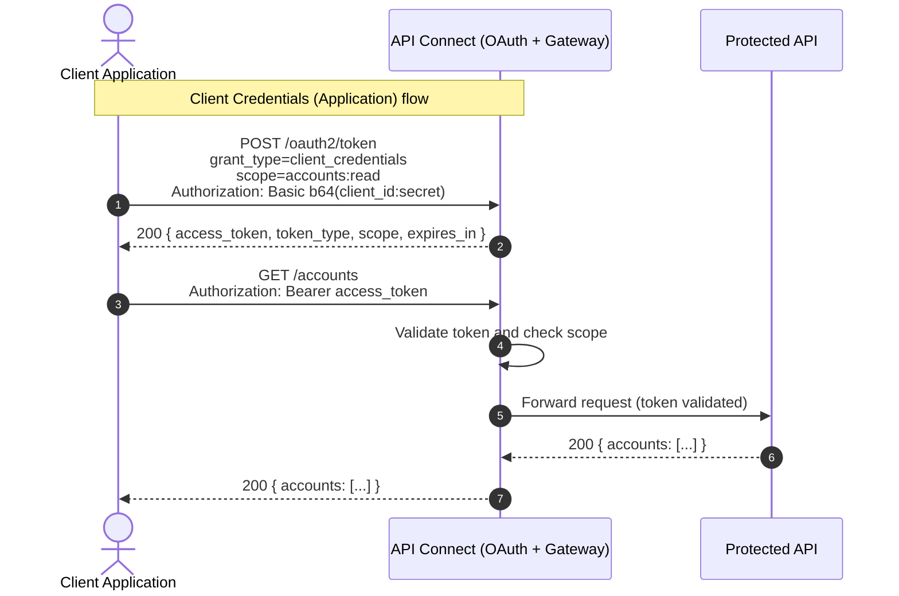
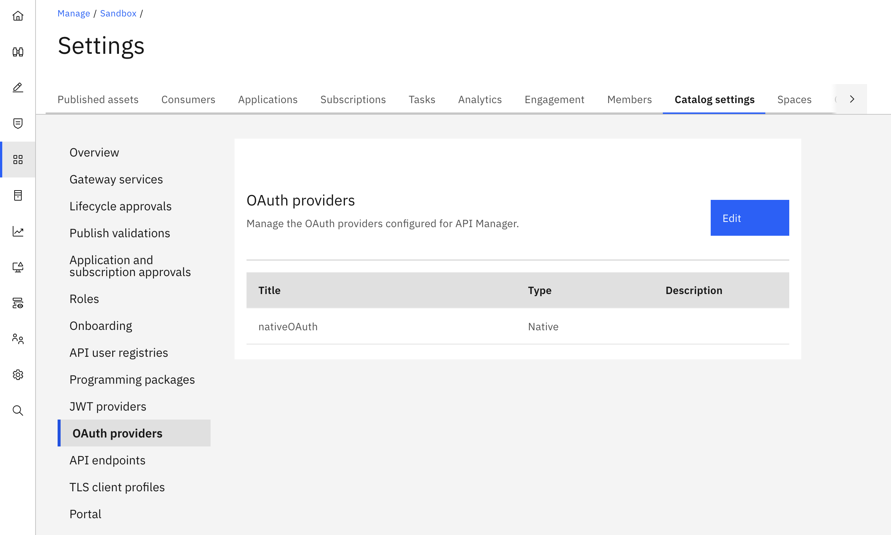

IBM API Connect includes a **native OAuth provider** that turns any API Connect catalog
into a full Authorization Server.  
This post walks through the entire life-cycle — from understanding OAuth 2.0 flows and designing scopes, to configuring the provider in API
Manager, protecting an API, consuming it through the Developer Portal, and inspecting
tokens via the introspection endpoint.

The worked example uses the **Client Credentials grant** (called *Application* in API
Connect) with a **confidential client** and an API deployed on the **DataPower API
Gateway**.

## OAuth 2.0 Flows in Brief

OAuth 2.0 defines several grant types, each suited to a different client/resource-owner situation.

| Grant type | APIC name | Use case |
|:---|:---|:---|
| **Client Credentials** | Application | Machine-to-machine, no user involved |
| **Authorization Code** | Access code | Web / mobile apps acting on behalf of a user |
| **Implicit** | Implicit | Legacy browser SPAs *(not recommended for new work)* |
| **Resource Owner Password** | Resource Owner – Password | Trusted first-party CLIs; migrating from basic auth |





**Why client credentials for this example?**  
APIs consumed by back-end services, daemons, or integration flows have no interactive
user.  
Client credentials is the right choice: the application authenticates directly
with its own identity (client ID + secret) and obtains an access token tied to the
application — not to any user.

---

## Scopes — Design and Best Practices

A **scope** is a named permission string that travels inside the access token.  
The gateway enforces it by comparing the scopes in the token against the scopes declared in the API security requirement.  

### Naming convention

```
<resource>:<action>
```

| Example scope | Meaning |
|:---|:---|
| `accounts:read` | Read (GET) operations on the Accounts resource |
| `accounts:write` | Mutating (POST / PUT / PATCH / DELETE) operations |
| `orders:read` | Read orders |
| `admin:all` | Elevated administrator access |

**Rules of thumb:**

1. **Least privilege** — define the narrowest scope that covers the use case. Never
   expose a single wildcard scope for all operations on a resource.
2. **Case-sensitive per RFC 6749** — stick to lowercase with colons as separators.
3. **Avoid action-only scopes** — `read`, `write` without a resource prefix collide
   between APIs sharing the same provider.
4. **Define a default scope** in the provider when all your APIs require at least one
   read scope, so that misconfigured requests receive a sensible fallback instead of an
   opaque error.
5. **Version scopes with your API only when breaking** — `accounts:read:v2` adds noise;
   prefer it only when the shape of the resource fundamentally changes.

### How scopes are checked by the gateway

Scope validation in API Connect follows two stages:

1. **Standard check** — the gateway compares the scopes in the access token against
   the list declared in the API's `security` definition. A mismatch returns HTTP 401 or
   403 depending on the gateway version.
2. **Advanced scope check** (optional) — an external URL is called at token generation or after token validation to let override or refine the granted scope

---

## APIC Configuration Walkthrough

### Step 1 — Create the Native OAuth Provider (Resources)

The OAuth provider is a reusable resource in API Manager.

1. Log into **API Manager**.
2. Navigate to **Resources → OAuth Providers**.
3. Click **Add → Native OAuth Provider**.
4. Fill in **Basic settings**:

   | Field | Value |
   |:---|:---|
   | Title | `Native OAuth` |
   | Name | `native-oauth` *(auto-filled)* |
   | Gateway type | `DataPower® API Gateway` |
   | Grant types | `Application` *(Client Credentials)* |
   | Client types | `Confidential` |
   | Authorize path | `/oauth2/authorize` *(default)* |
   | Token path | `/oauth2/token` *(default)* |
   | Scope 1 | `accounts:read` Read access to accounts|
   | Scope 2 | `accounts:write` Create and update accounts |

   > **Confidential client** means the client is expected to keep its secret safe
   > (e.g., a back-end service). *Public* clients cannot reliably keep secrets — use
   > PKCE with Authorization Code for those.

5. Click **Next / Save**.

The Native OAuth provider is created:  


### Step 2 — Configure Tokens

1. Click **Tokens** in the sidebar.
2. Recommended settings for a back-end flow:

   | Field | Value |
   |:---|:---|
   | Access token TTL | `3600` (1 hour) |
   | Maximum consent TTL | `86400` (24 hours) |
   | Refresh token | *Disabled* — not applicable for client credentials |

3. Click **Save**.

### Step 3 — Enable Introspection

1. Click **Introspection** in the sidebar.
2. Select the **Enable introspection** checkbox. The path `/oauth2/introspect` is
   filled automatically.
3. Click **Save**.

### Step 4 — Attach the Provider to a Catalog

1. Navigate to the **Catalog** where the API will be published.
2. Go to **Catalog Settings → OAuth providers**.
3. Add `native-oauth` to the catalog.

> Without this configuration you will not be able to deploy the API secured with OAuth.

 

---

## API Studio v12 Project

All files below live in the project `apic-native-oauth`.  
Download them individually from the links in the file list, or clone the whole folder.

### File overview

| File | Kind | Purpose |
|:---|:---|:---|
| [`accounts-spec.yml`](/assets/files/apic/apic-native-oauth/accounts-spec.yml) | OpenAPI 3.0 | API specification with OAuth security scheme |
| [`accounts-api.yml`](/assets/files/apic/apic-native-oauth/accounts-api.yml) | API | API Studio API asset |
| [`accounts-assembly.yml`](/assets/files/apic/apic-native-oauth/accounts-assembly.yml) | DataPowerAssembly | DataPower gateway assembly |
| [`accounts-plan.yml`](/assets/files/apic/apic-native-oauth/accounts-plan.yml) | Plan | Product plan (unlimited) |
| [`accounts-product.yml`](/assets/files/apic/apic-native-oauth/accounts-product.yml) | Product | Product wrapping the API |
| [`accounts-test.yml`](/assets/files/apic/apic-native-oauth/accounts-test.yml) | test | Test cases |
| [`accounts-environment.yml`](/assets/files/apic/apic-native-oauth/accounts-environment.yml) | environment | Test environment variables |
| [`accounts-get-200.yml`](/assets/files/apic/apic-native-oauth/accounts-get-200.yml) | assertion | Assertions for GET /accounts success |
| [`accounts-no-token.yml`](/assets/files/apic/apic-native-oauth/accounts-no-token.yml) | assertion | Assertion for unauthenticated call |
| [`accounts-post-forbidden.yml`](/assets/files/apic/apic-native-oauth/accounts-post-forbidden.yml) | assertion | Assertion for scope-rejected call |

### OpenAPI spec — security scheme

The critical part of [`accounts-spec.yml`](/assets/files/apic/apic-native-oauth/accounts-spec.yml):

```yaml
components:
  securitySchemes:
    nativeOAuth:
      type: oauth2
      x-ibm-oauth-provider: native-oauth    # must match the provider name in API Manager
      flows:
        clientCredentials:
          tokenUrl: https://$(catalog.url)/native-oauth/oauth2/token
          scopes:
            accounts:read: Read access to accounts
            accounts:write: Create and update accounts
```
> The value of x-ibm-oauth-provider should match the Native OAuth provider that you previously created. 
> The Native OAuth provider needs to be configured on the catalog where the API will be deployed
> At deployment, the gateway will search for this definition. If it is not configured an error will be generated

`$(catalog.url)` is an API Connect context variable that resolves to the catalog's
public endpoint at runtime. The security requirement on each operation lists which
scope(s) the token must carry:

```yaml
paths:
  /accounts:
    get:
      security:
        - nativeOAuth:
            - accounts:read
    post:
      security:
        - nativeOAuth:
            - accounts:write
```

> You can add on an existing API the OAuth configuration using the native OAuth provider that you created previously using the API Studio form.

<mark> In order to be able to configure the OAuth security scheme using the OAuth provider configured in API Manager, your API needs to be configured with a **DataPower API Gateway** policy sequence. This is because native OAuth Provider is currently only supported with this type of gateway and the API Studio enforces it.</mark> 


Steps to configure an existing API using the form:
1. Select your API and click on **Components** in the Outline view  
2. Scroll down and select "add security scheme"  

3. Provide a name for the security scheme key (here in the image **native-oauth**) and select **oauth2**. click add  

4. Select the right OAuth provider by connecting to the APIM configuration: api connect manager url, organisation and sandbox where the Native OAuth provider is configured <mark> you need to be connected to an APIC manager if you are using API Studio </mark>.  


The configuration from the OAuth provider is loaded.

### DataPower Assembly

[`accounts-assembly.yml`](/assets/files/apic/apic-native-oauth/accounts-assembly.yml)
is a `DataPowerAssembly` kind.  

The gateway handles OAuth enforcement automatically based on the security scheme in the OpenAPI spec — no explicit OAuth policy is needed in the
assembly.  

The assembly routes by operation and reads the validated token details from OAuth context variables and returns it to the caller (no backend invoque):

```yaml
- gatewayscript:
    title: Return accounts and token details
    source: |-
      var rsp = {
        accounts: [ ... ],
        caller: {
          client_id: context.get('oauth.verified_access_token.client_id'),
          scope: context.get('oauth.verified_access_token.scope')
        }
      };
      context.set('message.headers.content-type', 'application/json');
      context.set('message.status.code', 200);
      context.message.body.write(JSON.stringify(rsp));
```

Key OAuth context variables available after token validation (DataPower API Gateway):

| Variable | Description |
|:---|:---|
| `oauth.verified_access_token.client_id` | The subscriber's client ID |
| `oauth.verified_access_token.scope` | Scopes granted by the token |
| `oauth.verified_access_token.grant_type` | `client_credentials` |
| `oauth.verified_access_token.not_after` | Token expiry (Unix epoch) |

### Test cases

[`accounts-test.yml`](/assets/files/apic/apic-native-oauth/accounts-test.yml) contains
three requests:

1. **GET with valid bearer token** → expects HTTP 200 and a JSON body with `caller`.
2. **GET without any token** → expects HTTP 401.
3. **POST with a read-only token** (the environment `access_token` only carries
   `accounts:read`) → expects HTTP 4xx.

Run the tests from API Studio after setting the `access_token` environment variable (see the section on obtaining tokens below):

You can run the test using API Connect CLI (if installed):
```shell
apic test apic-native-oauth --localDir .
```

---

## Obtaining an Access Token

In the example, **Client Credentials** grant type as been used.  
In this flow, an application authenticates using its own credentials and receives an access token that can be used to invoke protected APIs.  

The process is straightforward:
1. Step 1 - **Subscribe to the API Product**
   From the Developer Portal, create an application and subscribe it to the API Product that exposes the desired API. 
   As part of the subscription process, the application receives a **Client ID** and **Client Secret** that uniquely identify it.
   Subscribing to the API can also be done from the API Manager UI.
2. Step 2 - **Identify the Token Endpoint**
   In the Developer Portal, review the API documentation to locate the OAuth token endpoint
   > Note: in the current Dev Portal release, the token url is found by inspecting the openAPI specification that can be downloaded from the **API Documentation** section of the API page in the DevPortal. 
   This endpoint is provided by the OAuth provider configured in API Connect and is used to request access tokens.
3. Step 3 - **Request an Access Token** 
   Use the application's **Client ID** and **Client Secret** to call the token endpoint with the `client_credentials` grant type. 
   If the credentials are valid, the OAuth provider returns an access token.

### Step 1. Subscription using the Dev Portal

1. Open the **Developer Portal**
2. Navigate to the section **Asset Gallery**, Select your API 
3. Select **API Products** section and click on the **Product**
4. On the **Plans** section, click **subscribe** to the plan you want to use
5. Click **Create new subscription** → give it a name 
6. Select your application
7. Note down the **Client ID** and **Client Secret** 

### Step 2. Get the OAuth token url
1. Open the **Developer Portal**
2. Navigate to the section **Asset Gallery**, Select your API 
3. Select **API Documentation** section and click on the **api.txt** to download the OpenAPI specification
4. The token url is provided in the openAPI.

> Note: the token url follows by default the pattern `https://<gateway-host>/<oauth-provider-name>/oauth2/token` 

### Step 3. Request an access token
Once you have obtained the Client ID and Client Secret of your subscribed application, you can request an access token from the OAuth token endpoint.

The Client Credentials grant type uses an HTTP POST request with a content type of `application/x-www-form-urlencoded`.   
The request must contain the `grant_type` parameter set to `client_credentials`.  
The client credentials are provided through HTTP Basic Authentication.  

```bash
curl -X POST https://api.example.com/native-oauth/oauth2/token \
  -H "Content-Type: application/x-www-form-urlencoded" \
  -u "<client-id>:<client-secret>" \
  --data-urlencode "grant_type=client_credentials" \
  --data-urlencode "scope=accounts:read customer.write"
```

> Note: When an API is consumed through a user-facing application, the Authorization Code grant type is typically used.  
> The user authenticates with the organization's Identity Provider, while the application authenticates itself using its client credentials.  
> The resulting access token represents both the authenticated user and the consuming application.

If the request is successfully authenticated, the OAuth provider returns a Bearer access token.  
This token can then be included in the `Authorization` header of subsequent API requests to access protected resources.

Expected response:

```json
{
  "token_type": "Bearer",
  "access_token": "AAEkNjV...",
  "scope": "accounts:read",
  "expires_in": 3600
}
```

## Calling the Protected API

The protected API is called by providing the Bearer token.  
If the token is valid and contains the right scopes, the API can be accessed.  

```bash
curl -k -X GET \
  "${GATEWAY_URL}/accounts/accounts" \
  -H "Authorization: Bearer ${TOKEN}" \
  -H "Accept: application/json"
```

A Bruno collection is also provided.

[Bruno](https://www.usebruno.com/) is an open-source API client (Git-friendly, no cloud account required). Create two requests in a Bruno collection.  
The first one, `get-token.bru`, requests the token and stores it in the environment.  
The second one, `get-accounts.bru`, calls the API with that token.  
A third request, `introspect.bru`, is also included — see the [Token Introspection](#token-introspection) section below.  

Set the following variables in your Bruno environment (`environments/local.bru`):

| Variable | Example | Notes |
|:---|:---|:---|
| `gateway_url` | `https://my-catalog.example.com/sb` | Your catalog gateway endpoint |
| `provider_path` | `native-oauth` | Base path of the OAuth provider |
| `client_id` | *(from the Portal)* | Replace the `YOUR_CLIENT_ID` placeholder |
| `client_secret` | *(declared in `vars:secret`)* | Fill in Bruno's Secrets panel; never committed to git |

Download the complete Bruno collection:
[`bruno/get-token.bru`](/assets/files/apic/apic-native-oauth/bruno/get-token.bru),
[`bruno/get-accounts.bru`](/assets/files/apic/apic-native-oauth/bruno/get-accounts.bru),
[`bruno/introspect.bru`](/assets/files/apic/apic-native-oauth/bruno/introspect.bru),
[`bruno/environments/local.bru`](/assets/files/apic/apic-native-oauth/bruno/environments/local.bru)
(or clone the blog repository and open the `assets/files/apic/apic-native-oauth/bruno/` folder
directly in Bruno).

---

## Token Introspection

Introspection lets an authorized holder examine the metadata of an existing token without parsing it.  
It conforms to [RFC 7662](https://tools.ietf.org/html/rfc7662).

The introspection endpoint is:

```
POST /<catalog-base-path>/native-oauth/oauth2/introspect
```

The caller must authenticate with the **same client ID and client secret** used to obtain the token (Basic authentication):

```bash
curl -k -X POST \
  "${GATEWAY_URL}/${PROVIDER_PATH}/oauth2/introspect" \
  -H "Content-Type: application/x-www-form-urlencoded" \
  --data-urlencode "token=${TOKEN}" \
  --data-urlencode "token_type_hint=access_token" \
  -u "${CLIENT_ID}:${CLIENT_SECRET}"
```

Example response for an active token:

```json
{
  "active": true,
  "token_type": "bearer",
  "client_id": "3f1e2d9a-0001-4abc-bdef-112233445566",
  "scope": "accounts:read",
  "exp": 1728940800,
  "expstr": "2026-10-14T23:59:59Z",
  "iat": 1728937200,
  "nbf": 1728937200,
  "grant_type": "client_credentials",
  "miscinfo": "[r:gateway]"
}
```

For an expired or revoked token, `active` will be `false`:

```json
{ "active": false }
```

