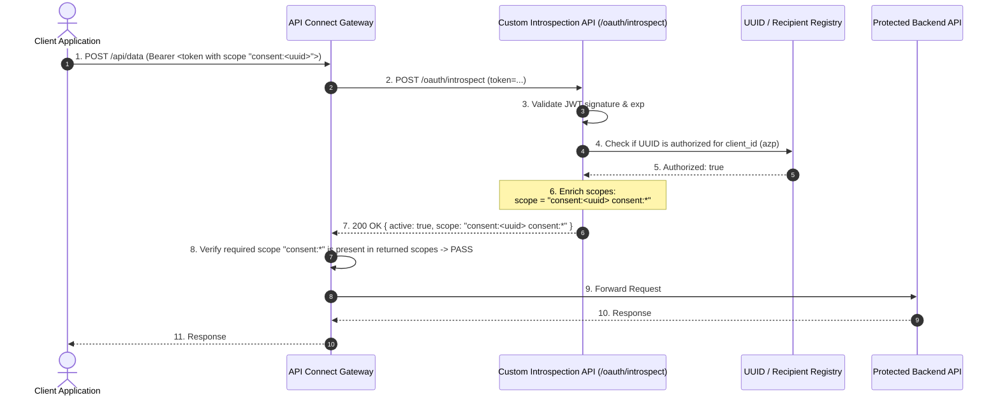
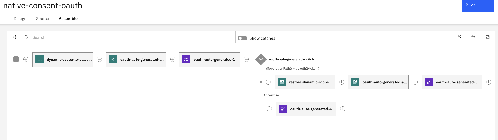
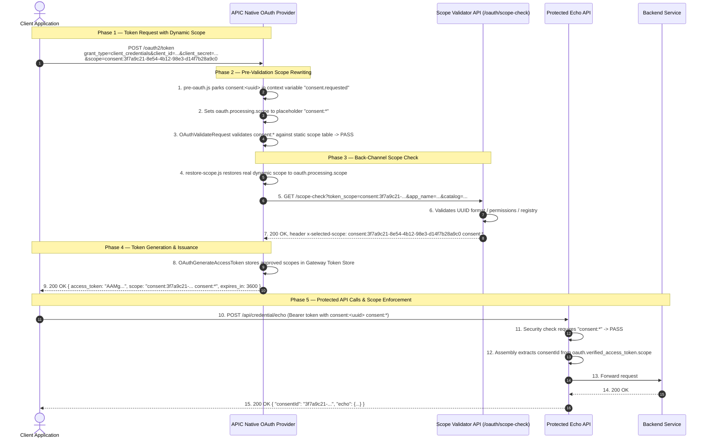

In standard OAuth 2.0 implementations, scopes are **static strings** pre-registered in the Authorization Server (for example: `read`, `write`, `accounts`, `payments`).  
However, modern enterprise APIs—especially in **Open Banking (PSD2 / FAPI)**, **Healthcare (HL7 FHIR)**, and **Multi-Tenant SaaS** platforms—frequently require **dynamic, parameterized scopes** bound to specific resources, consent IDs, account numbers, or transaction boundaries (such as `consent:3f7a9c21-8e54-4b12-98e3-d14f7b28a9c0` or `account:12345:read`).

This post explains how dynamic scopes work in **IBM API Connect (APIC)**:
1. What dynamic scopes are, the `*` naming convention, and key architectural use cases.
2. How **Third-Party OAuth** handles dynamic scopes using placeholder matching (`consent:*`).
3. How to adapt this pattern to **APIC's Native OAuth Provider** using the **"Advanced scope check before token generation"** hook **plus a small change in the provider assembly**.
4. The end-to-end request lifecycle and sequence diagram on the DataPower API Gateway.
5. A tested implementation (assets in [`assets/`](/assets/files/apic/apic-dynamic-scopes/)) with OpenAPI definitions, GatewayScript logic, APIC OAuth Provider settings, a deployment procedure and a test script.

> **Tested.** The native provider part was deployed and tested on an API Connect v12 DataPower API Gateway with the `client_credentials` grant. The first version of this post contained several definitions that do not work as written, they are corrected below and listed in [Section 10](#10-errata-what-changed-after-testing). The Authorization Code flow was **not** tested.

> **Related Posts in this Series:**
> - [Third-Party OAuth Provider in IBM API Connect](/assets/files/apic/apic-dynamic-scopes/APIC-OAuth-ThirdParty/) — Delegating token management to external IdPs (Auth0, Keycloak).
> - [Native OAuth Provider in IBM API Connect](/assets/files/apic/apic-dynamic-scopes/APIC-Native-OAuth/) — APIC as Authorization Server with standard static scopes.

---

## 1. What Are Dynamic Scopes and Why Use Them?

### Static vs Dynamic Scopes

| Attribute | Static Scopes | Dynamic (Parameterized) Scopes |
| :--- | :--- | :--- |
| **Definition** | Fixed, predefined strings registered at design time | Structured string templates parameterized at runtime |
| **Examples** | `read`, `write`, `payments`, `openid` | `consent:3f7a9c21-8e54-4b12-98e3-d14f7b28a9c0`, `account:ACC-98765:view` |
| **Cardinality** | Low (tens of scopes per organization) | Infinite (unique per consent, customer, account, or transaction) |
| **Enforcement** | Binary (client has scope or does not) | Contextual (client has permission *only* for the embedded resource ID) |
| **Standardization** | OAuth 2.0 (RFC 6749) | Open Banking UK / Berlin Group / FAPI / OAuth 2.0 Rich Authorization Requests (RAR - RFC 9396) |

### Why Use `*` (e.g. `consent:*`) in Scope Definitions?

In the OAuth 2.0 specification (RFC 6749), scopes are defined as opaque, space-delimited strings; the core standard does not mandate a specific wildcard format like `*`. However, using a wildcard suffix such as `consent:*` is a recognized **industry naming convention** adopted in Open Banking frameworks (such as the **Berlin Group NextGenPSD2** and **UK Open Banking**) as well as healthcare interoperability standards like **HL7 FHIR SMART on FHIR** to visually signal that an endpoint expects a *dynamic, parameterized scope*.

In **IBM API Connect**, defining `consent:*` applies to both **Third-Party** and **Native** OAuth providers and serves two critical purposes:

1. **API Definition & Documentation:** It makes it explicit in OpenAPI specifications and the Developer Portal that any sub-scope belonging to the `consent:` namespace is permitted.
2. **APIC Publish Validation Rule:** API Connect enforces strict integrity checks during deployment. **APIC will not allow you to deploy or publish an API requiring `consent:*` in its security scheme unless that exact scope name is explicitly registered in the scopes list of the referenced OAuth Provider**.

### Configuring Scopes in OpenAPI: AND vs OR Logic

When securing an API in OpenAPI (Swagger), you define how required scopes must be matched against the scopes in the validated token:

- **Logical AND (all scopes required):** Specify multiple scopes within the *same* security requirement array:
  ```yaml
  security:
    - oauth-provider:
        - 'account:read'
        - 'consent:*'
  ```
  *(The token must contain both `account:read` AND `consent:*`).*

- **Logical OR (any one scope required):** Specify separate security requirement objects in the `security` list:
  ```yaml
  security:
    - oauth-provider:
        - 'consent'
    - oauth-provider:
        - 'consent:*'
  ```
  *(The token is accepted if it contains either `consent` OR `consent:*`).*

### Real-World Use Cases

1. **Open Banking & PSD2 Consent Delegation:**  
   When an Account Information Service Provider (AISP) or Payment Initiation Service Provider (PISP) initiates a request, the token must be constrained to the specific consent object approved by the PSU (Payment Services User):  
   `scope=consent:3f7a9c21-8e54-4b12-98e3-d14f7b28a9c0`
2. **Account-Level Granular Access:**  
   Allowing a third-party app to access only a single bank account among many owned by the user:  
   `scope=accounts:IBAN-LU280019400644750000:read`
3. **Transaction-Bounded Authorizations:**  
   Embedding payment intent parameters into short-lived tokens:  
   `scope=payment:eur:max_amount_500:ref_TX99823`
4. **Healthcare (HL7 FHIR):**  
   Restricting clinical application access to a specific patient context:  
   `scope=patient:1048291:read`
5. **Multi-Tenant SaaS:**  
   Isolating tenant administrators to their specific organization partition:  
   `scope=tenant:org_904b3d13:manage`

---

## 2. Dynamic Scopes with Third-Party OAuth Provider (`consent:*`)

When using a **Third-Party OAuth Provider** in API Connect, token issuance and user authentication are handled by an external Identity Provider (IdP) such as Keycloak, Okta, PingFederate, or Auth0.

In this setup, APIC acts as the Resource Server and verifies tokens via token introspection (RFC 7662) or JWT signature verification.

### How Scope Validation Works During Introspection

When a client sends a request to a protected API:
1. **Client Request:** The client presents an access token containing the dynamic scope `consent:3f7a9c21-8e54-4b12-98e3-d14f7b28a9c0`.
2. **Gateway Interception:** APIC intercepts the request and issues an HTTP `POST` to the configured `introspection_endpoint`.
3. **The Scope Mismatch Problem:** The API definition requires scope `consent:*`. However, the raw token issued by the external IdP contains the dynamic UUID `consent:3f7a9c21-8e54-4b12-98e3-d14f7b28a9c0`, which literally does not match `consent:*`.
4. **Introspection Modification (Scope Enrichment):** Because the Introspection API is called **before** APIC performs scope validation, the introspection service can validate the dynamic UUID (and perform additional security checks such as verifying if the client `azp` is authorized for this recipient/UUID) and return an RFC 7662 response that appends `consent:*`:
   ```javascript
   // Inside Custom Introspection GatewayScript:
   var dynScope = "consent:3f7a9c21-8e54-4b12-98e3-d14f7b28a9c0 consent:*";
   context.message.body.write(JSON.stringify({
     active: true,
     client_id: azp,
     scope: dynScope,
     ...
   }));   // context.set('message.body', ...) does not write the body, see Section 10
   ```
5. **APIC Scope Evaluation Rule:** APIC receives `{ active: true, scope: "consent:3f7a9c21-... consent:*" }`. According to APIC's security engine, **an API call is granted if all scopes required by the API are present in the token's scope list**. Additional scopes in the token are allowed. Since `consent:*` is present, the request is approved!

### Third-Party Provider Configuration

Here is how the Third-Party OAuth Provider resource is configured in API Connect:

```json
{
  "type": "oauth_provider",
  "name": "third-party-oauth",
  "title": "Third-Party OAuth Provider",
  "provider_type": "third_party",
  "scopes": {
    "consent": "Static base namespace",
    "consent:*": "Dynamic scope placeholder for consent:<uuid>"
  },
  "grants": [
    "access_code"
  ],
  "third_party_config": {
    "token_validation_requirement": "active",
    "introspection_endpoint": {
      "endpoint": "https://<gw-host>/<org>/<catalog>/oauth/introspect"
    },
    "authorize_endpoint": "https://idp.example.com/realms/consumers/protocol/openid-connect/auth",
    "token_endpoint": "https://idp.example.com/realms/consumers/protocol/openid-connect/token"
  }
}
```

### Detailed Sequence Diagram



---

## 3. Adapting Dynamic Scopes to APIC Native OAuth Provider

When using **API Connect as the Native OAuth Provider (Authorization Server)**, the gateway issues, signs, and manages the token lifecycle directly.

### The Native OAuth Challenge

By default, APIC's Native OAuth engine strictly validates requested scopes against the static scopes defined in the OAuth Provider resource.
Requests with scopes that are not defined in the OAuth Provider resource will be rejected by default.  
If an application requests `scope=consent:3f7a9c21-8e54-4b12-98e3-d14f7b28a9c0`, APIC rejects the request immediately with:
```json
{
  "error": "invalid_scope",
  "error_description": "Scope is not allowed"
}
```
Because dynamic scope values are created at runtime, they cannot be pre-populated into APIC's static scope table.


### How to support Dynamic Scopes in Native OAuth


The Native OAuth provider compares the requested scope with its scope table and dynamic scope is therefore refused (`Scope is not allowed`) before the validator is ever called. 

To address this issue, the following configuration has been implemented:   



a GatewayScript (dynmamic-scope-to-place), is placed before the first OAuth policy scope validation (oauth-auto-generated-1), to remove any matching dynamic scope (f.e. consent:123) and replace by its static representation (f.e. consent:*). See [Component 2](#the-assembly-change-that-makes-dynamic-scopes-work).
The dynamic scope is injected back by a gatewayscript (restore-dynamic-scope) before the validator scope service (oauth-auto-generated).   

Scopes can be validated or injected into tokens using gatewayscript as described before or deleguated to external parties in two ways:

1. **"Advanced scope check before token generation" (Application scope check / Owner scope check):**
   - Configure **Application scope check** and/or **Owner scope check** URLs.
   - After application authentication, APIC makes a back-channel HTTP **`GET`** to the validator endpoint and passes the requested scope in the **`token_scope`** query parameter.
   - The validator approves the dynamic scope by returning the **`x-selected-scope` HTTP response header**, e.g. `consent:3f7a9c21-... consent:*`. The header is mandatory, a body is ignored.
   - The dynamic scope is injected back before the token generation by the `restore-scope.js` script that runs before the validator.
   - **Important note** The issued token must contain **both** the dynamic UUID and the placeholder `consent:*`. This is required to allow calling the API where the scope is set as dynamic `consent:*`. If the scope is not present the call will be rejected by the gateway. The called API can have an API assembly GatewayScript to validate the specific UUID if required. In the tested implementation the API service scope validator called before the token generation, acts as a **gate** (200 = accepted, anything else = the token request is refused)

2. **"Authentication URL User Registry" (`oauth_auth_url`):**
   - If user authentication is performed via an Authentication URL, the authentication service response can include the HTTP response header `x-selected-scope` to inject or override scopes embedded in the token.

### Scope Validation at Request Time: Token Generation vs Runtime Hooks

| Approach | Where Scope is Enriched | Runtime Overhead | How APIC Validates |
| :--- | :--- | :--- | :--- |
| **Token Generation Enrichment (Recommended)** | During token issuance via *Advanced scope check before token generation* and the assembly scripts | **Zero runtime overhead** | Native gateway checks `consent:*` in Gateway Token Store; Assembly GatewayScript checks UUID. |
| **Advanced scope check after token validation (`x-scopeValidate`)** | Evaluated on every API request | Extra HTTP call per API invocation | Gateway calls the `x-scopeValidate` URL after verifying standard token claims. Per the IBM documentation this call is an HTTP **`POST`** with a JSON body (not tested here), unlike the *before token generation* check above, which is a **`GET`**. |

```
┌────────────────────────────────────────────────────────────────────────────┐
│    IBM API Connect Gateway - token request (client_credentials, tested)    │
│                                                                            │
│ 1. Client  POST /oauth-native/oauth2/token   scope=consent:<uuid>          │
│ 2. Script 1 (pre-oauth.js)       consent:<uuid>  ->  consent:*             │
│       the scope table check (OAuthValidateRequest) passes              │
│ 3. Script 2 (restore-scope.js)   scope = consent:<uuid> consent:*          │
│ 3. Provider  --GET /oauth/scope-check?token_scope=consent:*--> Validator   │
│ 4. Scope Validator  --200 + header x-selected-scope-->  Provider           │
│ 6. Provider issues the token with "consent:<uuid> consent:*"               │
│ 7. Protected API: OAuth check needs consent:*, assembly extracts the UUID  │
└────────────────────────────────────────────────────────────────────────────┘
```

### End-to-End Sequence Flow

Here is the complete sequence flow using the **Client Credentials Grant (`client_credentials`)** with the internal Scope Validator and APIC Native OAuth opaque tokens:



---

## 4. What Needs to Be Configured: The Full Picture

To implement this architecture in API Connect, four components are configured:
- 2 APIs: one for scope validation and the other to protect the business API
- The Native OAuth Provider
- A subscription to be able to request a token

```
┌──────────────────────────────────────────────────────────────────────────────┐
│                              API Connect Catalog                             │
│                                                                              │
│  ┌────────────────────────────────────────────────────────────────────────┐  │
│  │ 1. Internal Scope Validator API                                        │  │
│  │    • Endpoint: GET /scope-check?token_scope=...                        │  │
│  │    • Receives query params (token_scope, app_name, org, catalog, ...)  │  │
│  │    • Regex / business check, 200 + x-selected-scope header, else 403   │  │
│  └────────────────────────────────────────────────────────────────────────┘  │
│                                      ▲                                       │
│                                      │ (Internal HTTP GET)                   │
│  ┌───────────────────────────────────┴────────────────────────────────────┐  │
│  │ 2. Native OAuth Provider Resource                                      │  │
│  │    • Scope Table: Static anchor "consent" (and "consent:*")            │  │
│  │    • Application scope check -> points to /scope-check                 │  │
│  │    • Assembly: 2 GatewayScripts (consent:<uuid> <-> consent:*)         │  │
│  │    • Grants: application (tested), access_code (not tested)            │  │
│  │    • User Security (access_code only): redirect to IdP, not tested     │  │
│  └────────────────────────────────────────────────────────────────────────┘  │
│                                      │                                       │
│                                      │ (Issues Token with dynamic scope)     │
│                                      ▼                                       │
│  ┌────────────────────────────────────────────────────────────────────────┐  │
│  │ 3. Protected Resource API (Echo API)                                   │  │
│  │    • Security Definition: references Native OAuth Provider             │  │
│  │    • Scopes: consent:* on one operation, consent on another            │  │
│  │    • Assembly: operation-switch, GatewayScript checks the UUID         │  │
│  │    • x-ibm-oauth-provider is required in the security scheme           │  │
│  └────────────────────────────────────────────────────────────────────────┘  │
│                                                                              │
│  ┌────────────────────────────────────────────────────────────────────────┐  │
│  │ 4. Product & Developer Portal Subscription                             │  │
│  │    • Package Protected API & OAuth Provider in a Product               │  │
│  │    • Consumer Application subscribes to obtain client_id & secret      │  │
│  └────────────────────────────────────────────────────────────────────────┘  │
└──────────────────────────────────────────────────────────────────────────────┘
```

---

## 5. Implementation & Working Examples

All assets in this section were deployed and tested on an API Connect v12 with DataPower API Gateway (`dp-gw`, catalog `sandbox`). The full, tested files are in [`post-assets/`](/assets/files/apic/apic-dynamic-scopes/). Only the minimum needed to understand each object is shown here, follow the links for the complete definitions.

Everything below was tested with the **`client_credentials`** grant (`application` in API Connect). 

| # | Object | File |
| :-- | :--- | :--- |
| 1 | Scope Validator API + product | [`oauth-scope-validator.yaml`](/assets/files/apic/apic-dynamic-scopes/oauth-scope-validator.yaml), [`scope-validator-product.yaml`](/assets/files/apic/apic-dynamic-scopes/scope-validator-product.yaml) |
| 2 | Native OAuth provider (org level) | [`native-consent-oauth.json`](/assets/files/apic/apic-dynamic-scopes/native-consent-oauth.json) |
| 2b | Catalog configuration of the provider | [`configured-native-consent-oauth.yaml`](/assets/files/apic/apic-dynamic-scopes/configured-native-consent-oauth.yaml) |
| 3 | Protected Echo API + product | [`echo-api.yaml`](/assets/files/apic/apic-dynamic-scopes/echo-api.yaml), [`echo-product.yaml`](/assets/files/apic/apic-dynamic-scopes/echo-product.yaml) |
| - | GatewayScripts used by the provider | [`pre-oauth.js`](/assets/files/apic/apic-dynamic-scopes/pre-oauth.js), [`restore-scope.js`](/assets/files/apic/apic-dynamic-scopes/restore-scope.js) |
| - | End-to-end test script | [`test.sh`](/assets/files/apic/apic-dynamic-scopes/test.sh) |

### Component 1 — Scope Validator API

The native provider calls this API **with an HTTP `GET`** and sends the requested scope in the **`token_scope` query parameter** (together with `app_name`, `app_id`, `org`, `catalog`, `trans_id` and `api_scope`). The answer is read from the **`x-selected-scope` response header**. The header is mandatory on a `200`, otherwise the token request fails. A non-200 answer rejects the token request.

Minimum to implement:

```yaml
servers:
  - url: /oauth                       # real URL: https://<gw-host>/<org>/<catalog>/oauth/scope-check
x-ibm-configuration:
  gateway: datapower-api-gateway
  assembly:
    execute:
      - gatewayscript:
          title: validate-dynamic-scope
          source: |
            var raw = context.get('request.parameters.token_scope.values[0]') || '';
            var requested = decodeURIComponent(String(raw).replace(/\+/g, ' ')).trim().split(/\s+/).filter(Boolean);
            // accept: consent | consent:<uuid> | consent:*
            // approved   -> status 200 + header  x-selected-scope: "consent:<uuid> consent:*"
            // otherwise  -> status 403
            context.set('message.headers.x-selected-scope', finalScope);   // + context.set('message.status.code', 200)
paths:
  /scope-check:
    get: { parameters: [ { name: token_scope, in: query, required: true } ] }
```

Full file: [`oauth-scope-validator.yaml`](/assets/files/apic/apic-dynamic-scopes/oauth-scope-validator.yaml). Quick check against the gateway:

```bash
curl -sk -i -G "$G/oauth/scope-check" --data-urlencode "token_scope=consent:3f7a9c21-8e54-4b12-98e3-d14f7b28a9c0"
# HTTP/2 200
# x-selected-scope: consent:3f7a9c21-8e54-4b12-98e3-d14f7b28a9c0 consent:*
```

### Component 2 — Native OAuth Provider

Minimum to configure:

| Setting | Value |
| :--- | :--- |
| Provider type | Native, gateway version `6000` (DataPower API Gateway) |
| Scope table | `consent` (static anchor) and `consent:*` (placeholder), nothing else |
| Grants | `application` (client credentials) as tested. |
| Advanced scope check before token generation, **Application scope check** | `https://<gw-host>/<org>/<catalog>/oauth/scope-check` |
| Base path / token path | `/oauth-native` and `/oauth2/token` (token URL is `https://<gw-host>/<org>/<catalog>/oauth-native/oauth2/token`) |

In the UI: **Resources > OAuth Providers > Add > Native OAuth provider**, then **Scopes** and fill the *Application scope check* endpoint. The same can be done from the CLI with the exported definition: [`native-consent-oauth.json`](/assets/files/apic/apic-dynamic-scopes/native-consent-oauth.json).

#### The assembly change that makes dynamic scopes work

The scope check endpoint alone is **not enough**. In the tests, a request for `consent:<uuid>` was answered with `invalid_scope - "Scope is not allowed"` and the validator was never called. The gateway compares the requested scope with the scope table in the first step of the provider assembly (`OAuthValidateRequest`), which runs **before** the advanced scope check.

The fix is two GatewayScript policies in the provider's own assembly (`native_provider.api`, token path):

```
 gatewayscript  dynamic-scope-to-placeholder   <- NEW, first policy of the assembly
 oauth          OAuthValidateRequest           (scope table check)
 switch  /oauth2/token
    gatewayscript  oauth-auto-generated-advanced-scope-application   (calls the scope check URL)
    gatewayscript  restore-dynamic-scope       <- NEW, right before token generation
    oauth          OAuthGenerateAccessToken, OAuthVerifyAZCode, ...
```

1. [`pre-oauth.js`](/assets/files/apic/apic-dynamic-scopes/pre-oauth.js) replaces every `consent:<uuid>` in `oauth.processing.scope` by the registered `consent:*` and keeps the original in the context variable `consent.requested`. The scope table check now passes.
The script defines the dynamic consent using the variable DYNAMIC_PREFIXES.  
> DYNAMIC_PREFIXES: adapt the variable in fonction of the scopes that have been defined in the Native OAuth Provider. I ddin't found a way to get those scopes from the definition at runtime.  
2. [`restore-scope.js`](/assets/files/apic/apic-dynamic-scopes/restore-scope.js) sets `oauth.processing.scope` back to `consent:<uuid> consent:*`, so the token carries both the real UUID and the placeholder. It overwrites the value returned by the validator, which is only a gate for dynamic scopes. 
2. The generated advanced scope check calls the Scope Validator. **Which scope it sends:** the generated script builds `token_scope` from `oauth.processing.scope`, which at this point already holds the placeholder set by step 1. Reading the script, the validator therefore receives `token_scope=consent:* consent:<uuid>`. A non-200 answer refuses the token request. On a 200 the generated script copies `x-selected-scope` into `oauth.processing.scope`.

```javascript
// pre-oauth.js (core)
  var DYNAMIC_PREFIXES = ['consent'];
  var raw = context.get('request.parameters.scope.values[0]');
  var requested = decodeURIComponent(String(raw || '').replace(/\+/g, ' '))
    .split(/\s+/).filter(Boolean);

  var dynamicMatches = [];
  var processed = requested.map(function (s) {
    for (var i = 0; i < DYNAMIC_PREFIXES.length; i++) {
      var prefix = DYNAMIC_PREFIXES[i] + ':';
      // Matches "consent:1234", "consent:<uuid>", but not "consent" or "consent:*"
      if (s.indexOf(prefix) === 0 && s.length > prefix.length && s !== (prefix + '*')) {
        dynamicMatches.push(s);
        return prefix + '*'; // Replaces "consent:1234" with "consent:*"
      }
    }
    return s;
  });
  if (dynamicMatches.length > 0) {
    // Store original dynamic scope(s) for restoration before token generation
    context.set('consent.requested', dynamicMatches.join(' '));
    // Set placeholder scope(s) for OAuthValidateRequest
    context.set('oauth.processing.scope', processed.join(' '));
  }

```

The provider must then be enabled in the catalog ([`configured-native-consent-oauth.yaml`](/assets/files/apic/apic-dynamic-scopes/configured-native-consent-oauth.yaml)). It only needs the `oauth_provider_url` of the org-level provider.

### Component 3 — Protected Echo API (three operations)

One API, three operations illustrating different scope protections (including logical OR):

| Operation | Required scope | Accepts |
| :--- | :--- | :--- |
| `POST /api/credential/echo` | `consent:*` (dynamic) | Tokens issued for `consent:<uuid>`. The assembly extracts the UUID and returns it as `consentId`. |
| `GET /api/status` | `consent` (static) | Tokens issued for the plain `consent` scope. |
| `DELETE /api/credential/echo` | `consent` OR `consent:*` (dual) | Tokens issued for **either** static `consent` **OR** dynamic `consent:*` (logical OR). |

Minimum to implement:

```yaml
x-ibm-configuration:
  gateway: datapower-api-gateway
  assembly:
    execute:
      - operation-switch:                      # one policy chain per operation
          case:
            - operations: [ { verb: post, path: /api/credential/echo } ]
              execute:
                - gatewayscript: { title: enforce-dynamic-scope }   # reads oauth.verified_access_token.scope, extracts <uuid>
                - gatewayscript: { title: dynamic-backend-response }
            - operations: [ { verb: get, path: /api/status } ]
              execute:
                - gatewayscript: { title: static-backend-response }
            - operations: [ { verb: delete, path: /api/credential/echo } ]
              execute:
                - gatewayscript: { title: dual-backend-response }
paths:
  /api/credential/echo:
    post:
      security: [ { native-consent-oauth: ['consent:*'] } ]
    delete:
      security:
        - native-consent-oauth: [ consent ]
        - native-consent-oauth: [ 'consent:*' ]
  /api/status:
    get:
      security: [ { native-consent-oauth: [ consent ] } ]
components:
  securitySchemes:
    native-consent-oauth:
      type: oauth2
      x-ibm-oauth-provider: native-consent-oauth      # REQUIRED on the DataPower API Gateway
      flows:
        clientCredentials:
          tokenUrl: https://<gw-host>/<org>/<catalog>/oauth-native/oauth2/token
          scopes: { consent: Static scope, 'consent:*': Dynamic scope placeholder }
```

Full file: [`echo-api.yaml`](/assets/files/apic/apic-dynamic-scopes/echo-api.yaml).

> - On the DataPower API Gateway the validated token is read from `oauth.verified_access_token.scope` and `oauth.verified_access_token.client_id`.
> - Write bodies with `context.message.body.write(...)`. Use `context.reject('Forbidden', '...')` with a `catch` on `RejectError` to shape the 403 body.

### Component 4 — Products and subscription

Both APIs are published through a product. The test application subscribes to the Echo product to obtain the `client_id` and `client_secret` used on the token endpoint. Files: [`scope-validator-product.yaml`](/assets/files/apic/apic-dynamic-scopes/scope-validator-product.yaml) and [`echo-product.yaml`](/assets/files/apic/apic-dynamic-scopes/echo-product.yaml). The validator product is published so the gateway exposes `/oauth/scope-check`. It does not need a subscription, because the provider calls it from inside the gateway.

---

## 6. Testing the Flow End-to-End

The tests below were run against a real gateway with the `client_credentials` grant. The whole sequence is automated in [`test.sh`](/assets/files/apic/apic-dynamic-scopes/test.sh), which reads the gateway URL and the application credentials from environment variables:

```bash
export GW_BASE=https://<gw-host>/<provider-org>/<catalog>
export CLIENT_ID=<client id of the subscribed application>
export CLIENT_SECRET=<client secret>        # never commit this value
export CURL_OPTS=-k                          # only for a self-signed gateway certificate
./post-assets/test.sh
```

### Step 1 — Request a token with a dynamic scope

```bash
curl -s -X POST "$GW_BASE/oauth-native/oauth2/token" \
  -d grant_type=client_credentials \
  -d client_id="$CLIENT_ID" -d client_secret="$CLIENT_SECRET" \
  --data-urlencode "scope=consent:3f7a9c21-8e54-4b12-98e3-d14f7b28a9c0"
```

```json
{
  "token_type": "Bearer",
  "access_token": "AAMg...",
  "scope": "consent:3f7a9c21-8e54-4b12-98e3-d14f7b28a9c0 consent:*",
  "expires_in": 3600
}
```

The token carries the real UUID **and** the placeholder `consent:*`. A request for the static scope returns `"scope": "consent"`.

### Step 2 — Call the operation protected by the dynamic scope

```bash
curl -s -X POST "$GW_BASE/echo-dynamic/api/credential/echo" \
  -H "Authorization: Bearer $TOKEN" -H "Content-Type: application/json" -d '{"a":1}'
```

```json
{
  "status": "success",
  "message": "Authorized with dynamic scope",
  "consentId": "3f7a9c21-8e54-4b12-98e3-d14f7b28a9c0",
  "client_id": "<client id>",
  "scope": "consent:3f7a9c21-8e54-4b12-98e3-d14f7b28a9c0 consent:*",
  "echo": { "a": 1 }
}
```

### Step 3 — Call the operation protected by the static scope

```bash
curl -s "$GW_BASE/echo-dynamic/api/status" -H "Authorization: Bearer $STATIC_TOKEN"
# {"status":"success","message":"Authorized with static scope consent","scope":"consent", ...}
```

### Step 4 — Call the operation protected by dual scope (logical OR)

`DELETE /api/credential/echo` accepts either token:

```bash
# With dynamic token (consent:*)
curl -s -X DELETE "$GW_BASE/echo-dynamic/api/credential/echo" -H "Authorization: Bearer $TOKEN"
# {"status":"success","message":"Authorized with dual scope (consent OR consent:*)", ...}

# With static token (consent)
curl -s -X DELETE "$GW_BASE/echo-dynamic/api/credential/echo" -H "Authorization: Bearer $STATIC_TOKEN"
# {"status":"success","message":"Authorized with dual scope (consent OR consent:*)", ...}
```

### Step 5 — Negative tests

| Request | Result |
| :--- | :--- |
| Token with `scope=consent:evil` (bad format) | `invalid_scope` |
| Token with `scope=other` (not registered) | `invalid_scope` |
| `POST /api/credential/echo` with the **static** token | `401`, the token has no `consent:*` |
| `GET /api/status` with the **dynamic** token | `401`, the token has no `consent` |
| `DELETE /api/credential/echo` with garbage token or no token | `401` |
| Any operation with a garbage token or no token | `401` |

### Results of the test run

```
== 1. Scope Validator (called directly, as the provider does: GET + token_scope)
PASS  validator consent                                              200
PASS  validator consent:<uuid>                                       200
PASS  validator consent:evil                                         403
== 2. Token endpoint
PASS  token scope=consent                                            consent
PASS  token scope=consent:<uuid>                                     consent:3f7a9c21-8e54-4b12-98e3-d14f7b28a9c0 consent:*
PASS  token scope=consent:evil                                       invalid_scope
PASS  token scope=other                                              invalid_scope
== 3. Echo API
PASS  POST   /api/credential/echo  dynamic token (consent:*)         200
PASS  POST   /api/credential/echo  static token                      401
PASS  POST   /api/credential/echo  garbage token                     401
PASS  GET    /api/status           static token (consent)            200
PASS  GET    /api/status           dynamic token                     401
PASS  GET    /api/status           no token                          401
PASS  DELETE /api/credential/echo  dynamic token (consent:*)         200
PASS  DELETE /api/credential/echo  static token (consent)            200
PASS  DELETE /api/credential/echo  garbage token                     401
PASS  DELETE /api/credential/echo  no token                          401
passed=17 failed=0
```

> **Why `401` and not `403` for a wrong scope?** The gateway's OAuth security check runs before the assembly. When the token does not contain the scope required by the operation, it answers `401 invalid_token`. The `403` written by the assembly is only reached when the token has `consent:*` but no valid `consent:<uuid>`.


## 7. Deploying the Complete Solution with the API Connect Toolkit CLI

The toolkit CLI is `apic` in the IBM documentation and may be installed under another name (`apiccli` in the test environment). The commands are identical. `<mgmt>` is the management endpoint host, `<org>` the provider organization and `sandbox` the catalog. The commands for validate, publish, `oauth-providers:*`, `configured-oauth-providers:create`, `products:get` and `subscriptions:create` were run as written. `login`, `apps:create` and `--migrate_subscriptions` come from the CLI help and were **not** run in the test.

```bash
export MGMT=<mgmt>            # e.g. api.<domain>
export ORG=<org>
export CAT=sandbox
FLAGS="-s $MGMT -o $ORG -c $CAT --scope catalog"      # add --insecure-skip-tls-verify for self-signed certificates

apic login --server $MGMT --realm provider/<idp-name>   # prompts for user and password
```

### Step 1 — Publish the Scope Validator

```bash
apic validate post-assets/oauth-scope-validator.yaml
apic products:publish post-assets/scope-validator-product.yaml $FLAGS
```

### Step 2 — Create the Native OAuth provider

The provider is created at **org level**, then enabled in the catalog. Two points matter:

1. The provider assembly name must be `<provider-name><provider-id>`, and the id only exists after creation. Create the provider first, then update it with the full definition.
2. Create it from the UI or from an existing complete definition. A provider created from a minimal definition has a token path that only echoes the request.

```bash
# 2a. create the provider (UI: Resources > OAuth Providers > Add > Native OAuth provider), then read its id
apic oauth-providers:get native-consent-oauth -s $MGMT -o $ORG

# 2b. update it with the tested definition: scopes consent + consent:*, application grant,
#     scope check URL, and the two GatewayScripts (pre-oauth.js, restore-scope.js).
#     Adapt the x-ibm-name and the ADVScopesApplicationUrl property to your environment first.
apic oauth-providers:update native-consent-oauth post-assets/native-consent-oauth.json -s $MGMT -o $ORG

# 2c. enable it in the catalog (oauth_provider_url must point to the org-level provider)
apic configured-oauth-providers:create post-assets/configured-native-consent-oauth.yaml $FLAGS
```

### Step 3 — Publish the Protected Echo API

```bash
apic validate post-assets/echo-api.yaml
apic products:publish post-assets/echo-product.yaml $FLAGS
```

The publish fails if the OAuth provider is not yet enabled in the catalog, because the security scheme references it.

### Step 4 — Create the application and subscribe

```bash
cat > app.yaml <<'YAML'
title: dyn-scope-app
name: dyn-scope-app
YAML
apic apps:create app.yaml $FLAGS --consumer-org <consumer-org>
# the client id and secret are returned when the credentials are created (apic credentials:create ... --app dyn-scope-app),
# or read them from the application in the UI
```

Create the subscription with the URL of the published Echo product:

```bash
apic products:get echo-dynamic-oauth-product:1.0.0 $FLAGS --fields url
cat > sub.yaml <<'YAML'
title: dyn-scope-sub
name: dyn-scope-sub
product_url: <url returned above>
plan: default
YAML
apic subscriptions:create sub.yaml $FLAGS --app dyn-scope-app --consumer-org <consumer-org>
```

### Step 5 — Test

```bash
export GW_BASE=https://<gw-host>/$ORG/$CAT CLIENT_ID=<id> CLIENT_SECRET=<secret>
./post-assets/test.sh
```

### Republishing a product removes its subscriptions

Publishing `echo-product.yaml` again creates a new product id and the subscription of the test application is dropped. The token endpoint then answers `unauthorized_client` ("client not subscribed to this API"). Either recreate the subscription as in Step 4, or republish with `--migrate_subscriptions`:

```bash
apic products:publish post-assets/echo-product.yaml $FLAGS --migrate_subscriptions
```

---

## 8. Resources

- [OAuth 2.0 Authorization Framework (RFC 6749)](https://datatracker.ietf.org/doc/html/rfc6749)
- [OAuth 2.0 Rich Authorization Requests (RFC 9396)](https://datatracker.ietf.org/doc/html/rfc9396)
- [IBM API Connect Documentation – Configuring a Native OAuth Provider](https://www.ibm.com/docs/en/api-connect)
- [IBM API Connect Documentation – Advanced Scope Check](https://www.ibm.com/docs/en/api-connect)
- [Companion: Native OAuth Provider in IBM API Connect](/assets/files/apic/apic-dynamic-scopes/APIC-Native-OAuth/)
- [Companion: Third-Party OAuth Provider in IBM API Connect](/assets/files/apic/apic-dynamic-scopes/APIC-OAuth-ThirdParty/)
