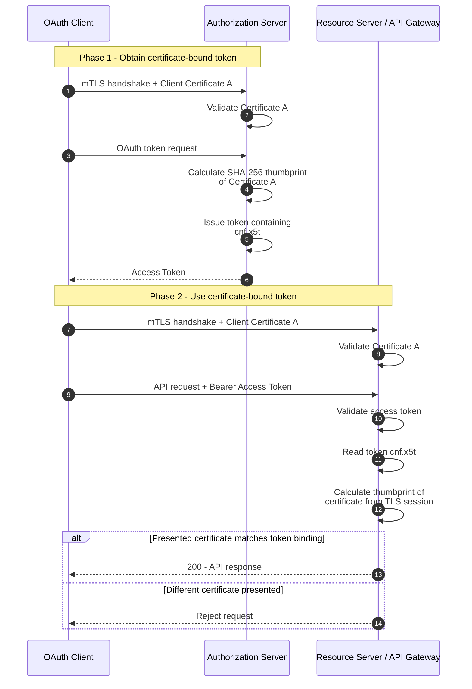
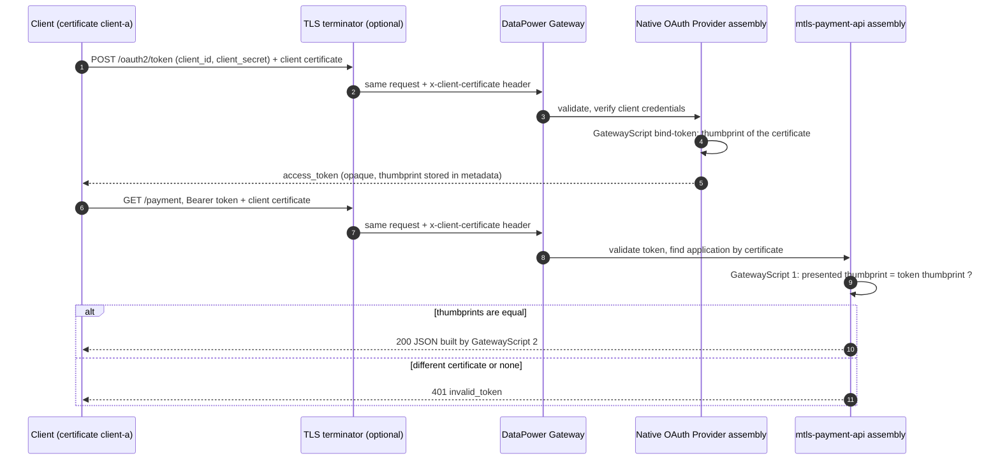

A bearer token is like cash: whoever holds it can spend it. If a token leaks (logs, a proxy, a compromised client, a man in the middle), the thief can call your API. 
**RFC 8705 (OAuth 2.0 Mutual-TLS Client Authentication and Certificate-Bound Access Tokens)** removes that weakness by tying the token to the **X.509 certificate** of the client that requested it.

This post explains how to support this RFC in **IBM API Connect (APIC)**:
1. What RFC 8705 defines and why it is used (FAPI, Open Banking, PSD2).
2. How API Connect supports it.
3. How to configure the **Native OAuth Provider** so that it binds the access token to the client certificate.
4. How to create the **exposed API**, which verifies the binding.
5. How to configure the **application** with its client certificate.
6. A complete example and manual `curl` tests and the deployment with the toolkit CLI.
7. An alternative that parses the certificate with **XSLT** (`dp:get-cert-details`) on the DataPower API Gateway.

> The provided assets have been tested an API Connect v12 DataPower API Gateway with the `client_credentials` grant. The test script can be found at  [`test.sh`](/assets/files/apic/apic-mtls-oauth/test.sh).

> **Related Posts in this Series:**
> - [Native OAuth Provider in IBM API Connect](/apic/APIC-Native-OAuth/) — APIC as Authorization Server with standard static scopes.
> - [Dynamic Scopes in IBM API Connect](/apic/2026-11-19-APIC-Dynamic-Scopes/) — Native provider assembly hooks and GatewayScript in the token path.

---

## 1. What Is RFC 8705 and Why Use It?

RFC 8705 defines two independent mechanisms. Both rely on mutual TLS (mTLS), where the client also presents a certificate during the TLS handshake.

### Mechanism 1 — Mutual-TLS client authentication (section 2)

The client authenticates to the **token endpoint** with its certificate instead of (or in addition to) a `client_secret`.   
The `client_id` is still sent, the certificate proves who the client is.

| `token_endpoint_auth_method` | How the authorization server recognises the certificate |
| :--- | :--- |
| `tls_client_auth` | Certificate issued by a trusted CA. The server matches a subject attribute (DN, SAN dns/uri/ip/email) registered for the client. |
| `self_signed_tls_client_auth` | Self-signed certificate. The client registers the certificate (or its JWKS) and the server compares it with the one presented. |

### Mechanism 2 — Certificate-bound access tokens (section 3)

The authorization server **binds the access token to the client certificate**.  

When issuing the token, the Authorization Server records a SHA-256 thumbprint of the client's certificate in the cnf claim using the x5t#S256 confirmation method.  
When the token is later presented to an API over mTLS, the Resource Server verifies that the certificate presented during the TLS connection has the same thumbprint.  
A stolen access token alone is therefore insufficient to access the protected resource. This behavior is standardized by RFC 8705.



The binding consists to include in the geenrated token a claim `cnf` that carries the SHA-256 thumbprint of the DER encoded certificate.

```json
{
  "iss": "https://as.example.com",
  "sub": "client-a",
  "scope": "payment",
  "cnf": { "x5t#S256": "E09DciAcZk0sluvrc9jJdqN3ixHMKQ-Bppti5WlMjyc" }
}
```

### x5t#s256 computation
The value is calculated from the client's X.509 certificate:

```
Client X.509 certificate
|
| DER encoding of certificate
v
SHA-256
|
| 32-byte digest
v
Base64URL encoding
|
| remove "=" padding
v
x5t#S256
```

More formally:
```
x5t#S256 = BASE64URL(SHA-256(DER(client_certificate)))
``` 

### Why it is used

| Need | How RFC 8705 helps |
| :--- | :--- |
| **Token theft / replay** | The token cannot be used from another client, the attacker would need the private key. |
| **Strong client authentication** | A private key never travels on the wire, unlike a shared secret. |
| **Regulation and profiles** | **FAPI 1.0 Advanced** (Open Banking UK, Brazil, Australia CDR), **PSD2 / Berlin Group** and many financial profiles require mTLS client authentication and sender-constrained tokens. |
| **Machine to machine** | Natural fit for B2B and service-to-service where each partner already owns a certificate. |

The alternative sender-constraint mechanism is DPoP (RFC 9449), which works at the application layer and does not need mTLS.

---

## 2. How Is RFC 8705 Supported in API Connect?

To support this specification, you need to modify the Native OAuth provider assembly policy.  
The implementation has been made using simple gatewayscript.  

| Building block | Where | Used for |
| :--- | :--- | :--- |
| **Application certificate** | Application field `application_public_certificate_entry` (UI: *Application > Certificates*) | Registers the certificate of the client, the "self-signed" model of the RFC. |
| **Certificate-based application authentication** | API: `x-ibm-configuration.application-authentication: { certificate: true }` and `application-authentication-source: [header]` or `[tls-cert]` | The gateway finds the application whose registered certificate matches the one presented, and fills `application.certificate.*`. |
| **Certificate context variables** | `application.certificate.Subject`, `.Issuer`, `.fingerprint`, `.Base64` | API Connect provides certificate information from the certificate in the assembly. |
| **Client certificate header** | `x-client-certificate` | Certificate relayed by a TLS terminating component (load balancer, ingress, router). |
| **Token metadata at runtime** | `oauth.verified_access_token.misc_info` (and `.client_id`, `.scope`) in the protected API | Information provided by API Connect as environment variable populated by data from the token. |
| **Parsed token** | `oauth.verified_access_token.*` | APIC validates the token and exposes `client_id`, `scope` and the stored metadata (`misc_info`). |.  

The design used in this post:

- **Token endpoint** (native provider): a GatewayScript placed before `OAuthGenerateAccessToken` computes `x5t#S256` of the presented certificate and stores it in the token metadata. This is the equivalent of the `cnf` claim.
- **Protected API**: certificate-based application authentication is enabled, and APIC parses the presented certificate (`application.certificate.*`) and the token (`oauth.verified_access_token.*`), and a GatewayScript only compares the two values. No hash is computed in the API. A mismatch returns `401 invalid_token`.
- **Response**: a second GatewayScript writes the JSON body. There is **no `invoke`** policy, no back end.

---

## 3. What Needs to Be Configured: The Full Picture

```
┌──────────────────────────────────────────────────────────────────────────────┐
│                              API Connect Catalog                             │
│                                                                              │
│  ┌────────────────────────────────────────────────────────────────────────┐  │
│  │ 1. Native OAuth Provider  "mtls-oauth"                                 │  │
│  │    • Scope: payment            • Grant: application (client_credentials)│ │
│  │    • Token path: verify -> GatewayScript bind-token -> generate token  │  │
│  │    • bind-token.js stores x5t#S256 of the presented certificate        │  │
│  └─────────────────────────────────────┬──────────────────────────────────┘  │
│                                        │ issues token + metadata             │
│                                        ▼                                     │
│  ┌────────────────────────────────────────────────────────────────────────┐  │
│  │ 2. Protected API  "mtls-payment-api"   GET /payment                    │  │
│  │    • OAuth security scheme -> mtls-oauth                               │  │
│  │    • application-authentication: certificate (source: header)          │  │
│  │    • GatewayScript 1: presented thumbprint == token thumbprint ?       │  │
│  │    • GatewayScript 2: builds the 200 response (no invoke)              │  │
│  └────────────────────────────────────────────────────────────────────────┘  │
│                                                                              │
│  ┌────────────────────────────────────────────────────────────────────────┐  │
│  │ 3. Product "mtls-payment-product" + Application "mtls-app"             │  │
│  │    • Application holds the client certificate (client-a)               │  │
│  │    • Subscription gives client_id / client_secret                      │  │
│  └────────────────────────────────────────────────────────────────────────┘  │
└──────────────────────────────────────────────────────────────────────────────┘
```




---

## 4. Implementation & Working Examples

| # | Object | File |
| :-- | :--- | :--- |
| 1 | Native OAuth provider (org level) | [`mtls-oauth.json`](/assets/files/apic/apic-mtls-oauth/mtls-oauth.json) |
| 1b | Catalog configuration of the provider | [`configured-mtls-oauth.yaml`](/assets/files/apic/apic-mtls-oauth/configured-mtls-oauth.yaml) |
| 2 | Protected API (GatewayScript only) + product | [`mtls-api.yaml`](/assets/files/apic/apic-mtls-oauth/mtls-api.yaml), [`mtls-product.yaml`](/assets/files/apic/apic-mtls-oauth/mtls-product.yaml) |
| 3 | Application with its certificate | [`app.yaml`](/assets/files/apic/apic-mtls-oauth/app.yaml), [`prepare-app.sh`](/assets/files/apic/apic-mtls-oauth/prepare-app.sh) |
| 4 | Subscription | [`sub.yaml`](/assets/files/apic/apic-mtls-oauth/sub.yaml) |
| - | GatewayScript of the token path | [`bind-token.js`](/assets/files/apic/apic-mtls-oauth/bind-token.js) |
| - | Test certificates (self-signed) | [`gen-certs.sh`](/assets/files/apic/apic-mtls-oauth/gen-certs.sh), `certs/client-a.crt`, `certs/client-b.crt` |
| - | End-to-end test script | [`test.sh`](/assets/files/apic/apic-mtls-oauth/test.sh) |
| - | XSLT variant (section 7) | [`mtls-xslt-api.yaml`](/assets/files/apic/apic-mtls-oauth/mtls-xslt-api.yaml), [`mtls-xslt-product.yaml`](/assets/files/apic/apic-mtls-oauth/mtls-xslt-product.yaml), [`xslt/parse-cert.xsl`](/assets/files/apic/apic-mtls-oauth/xslt/parse-cert.xsl), [`xslt/normalize-cert.js`](/assets/files/apic/apic-mtls-oauth/xslt/normalize-cert.js) |

Private keys (`certs/*.key`) are ignored by git, regenerate them with `gen-certs.sh`.

### 4.1 — Native OAuth provider

Start from a provider created in the UI (*Resources > OAuth Providers > Add > Native OAuth provider*) and apply [`mtls-oauth.json`](/assets/files/apic/apic-mtls-oauth/mtls-oauth.json). The settings that matter:

| Setting | Value |
| :--- | :--- |
| Name | `mtls-oauth` |
| Scope | `payment` |
| Supported grant types | `application` (client credentials) |
| Client type | `confidential` |
| Token path / base path | `/oauth2/token` under `/mtls-oauth` |
| Authorize path | not used, the `authorize` operation is removed from the provider API |

The token path of the provider assembly (`switch` case `/oauth2/token`) is the standard one with one extra step:

```
validate-request  ->  verify-and-collect  ->  bind-token-to-certificate (GatewayScript)  ->  generate-access-token
``` 


The GatewayScript [`bind-token.js`](/assets/files/apic/apic-mtls-oauth/bind-token.js):

```javascript
var crypto = require('crypto');

var raw = context.get('request.headers.x-client-certificate');   // relayed by the TLS terminator
var b64 = String(raw || '')
  .replace(/-----BEGIN CERTIFICATE-----|-----END CERTIFICATE-----/g, '')
  .replace(/\s+/g, '');

if (!b64) {
  context.reject('invalid_client', 'A client certificate is required to obtain a certificate-bound token');
  context.message.statusCode = '401 Unauthorized';
} else {
  var der = Buffer.from(b64, 'base64');
  // RFC 8705 "cnf" value: SHA-256 thumbprint of the DER certificate, base64url
  var x5t = crypto.createHash('sha256').update(der).digest('base64')
    .replace(/\+/g, '-').replace(/\//g, '_').replace(/=+$/, '');
  // same format as the context variable application.certificate.fingerprint (SHA-1, hex with colons)
  var fp = crypto.createHash('sha1').update(der).digest('hex').toUpperCase().replace(/(..)(?=.)/g, '$1:');
  var binding = 'x5t#S256=' + x5t + ';fp=' + fp;
  context.set('oauth.processing.metadata.access_token', binding);   // inside the token -> misc_info
  context.set('oauth.processing.metadata.payload', binding);        // returned to the client as "metadata" field in the response
}
```
Two values are stored: 
- `x5t#S256`, the RFC 8705 `cnf` value
- `fp`, the fingerprint in the exact format of `application.certificate.fingerprint`

OAuth token record

```json
{
   access_token: "AAE....",
   client_id: "client-a",
   scope: "payment",
   ...
   miscinfo: "x5t#S256=...;fp=..."
}
```
Native OAuth Provider response: 

```
{
  "token_type": "bearer",
  "access_token": "AAEkNzhjDHYyyYy...cL0Mv6ctl37w7ZU",
  "expires_in": 3600,
  "scope": "payment",
  "metadata": "x5t#S256=...;fp=..."
}
```
The protected API can compare without any cryptographic code. Both `oauth.processing.metadata.access_token` (stored in the token, read back as `misc_info`) **and** `.payload` (returned to the client as `metadata`) are set. 

The thumbprint is computed **once**, when the token is issued.   

Two rules learned in the previous post still apply:

The token metadata feature (`token_metadata.enabled: true`) is enabled in the provider.  

### 4.2 — The exposed API (GatewayScript only)

[`mtls-api.yaml`](/assets/files/apic/apic-mtls-oauth/mtls-api.yaml) exposes `GET /payment`, protected by the OAuth scheme that points to the provider, and by the certificate-based application authentication:

```yaml
x-ibm-configuration:
  gateway: datapower-api-gateway
  application-authentication:
    certificate: true
  application-authentication-source:
    - header
components:
  securitySchemes:
    mtls-oauth:
      type: oauth2
      x-ibm-oauth-provider: mtls-oauth
      flows:
        clientCredentials:
          tokenUrl: https://$(catalog.url)/mtls-oauth/oauth2/token
          scopes:
            payment: payment scope
security:
  - mtls-oauth: [payment]
```

`application-authentication-source` accepts `header` (certificate relayed in `x-client-certificate`) and `tls-cert` (certificate of the TLS session). See section 4.4 for which one to use.

The assembly contains **two GatewayScript policies**.

**GatewayScript 1 — verify the binding (RFC 8705 section 3.2):**

```javascript
// APIC has already parsed the client certificate (application.certificate.*)
// and the access token (oauth.verified_access_token.*): no crypto needed here.
var fp = context.get('application.certificate.fingerprint');
var bound = String(context.get('oauth.verified_access_token.misc_info') || '');

// binding stored in the token by the provider: x5t#S256=<hash>;fp=<fingerprint>
var m = /x5t#S256=([^;]+);fp=(.+)$/.exec(bound);

if (!fp || !m || m[2] !== fp) {
  context.message.statusCode = '401 Unauthorized';
  context.message.header.set('Content-Type', 'application/json');
  context.message.header.set('WWW-Authenticate', 'Bearer error="invalid_token", error_description="certificate does not match the token binding"');
  context.message.body.write(JSON.stringify({ error: 'invalid_token',
    error_description: 'The client certificate does not match the certificate the token is bound to' }));
} else {
  context.set('mtls.x5t', m[1]);
}
```

**GatewayScript 2 — build the response as mockup**

```javascript
if (context.get('mtls.x5t')) {
  context.message.statusCode = '200 OK';
  context.message.header.set('Content-Type', 'application/json');
  context.message.body.write(JSON.stringify({
    status: 'ok',
    message: 'Certificate-bound token accepted',
    client_id: context.get('oauth.verified_access_token.client_id'),
    scope: context.get('oauth.verified_access_token.scope'),
    certificate_subject: context.get('application.certificate.Subject'),
    certificate_issuer: context.get('application.certificate.Issuer'),
    certificate_fingerprint: context.get('application.certificate.fingerprint'),
    'cnf': { 'x5t#S256': context.get('mtls.x5t') }
  }));
}
```

The first script writes the 401 response, the second one only writes when the check passed.    
The API is packaged with a plan in [`mtls-product.yaml`](/assets/files/apic/apic-mtls-oauth/mtls-product.yaml).

### 4.3 — The application and its certificate

The application holds the **public certificate** of the client. In the toolkit, the field is `application_public_certificate_entry` and takes the **full PEM** with `\n` for line breaks:

```yaml
title: mtls-app
name: mtls-app
application_public_certificate_entry: "-----BEGIN CERTIFICATE-----\nMIIC...\n-----END CERTIFICATE-----\n"
```

[`prepare-app.sh`](/assets/files/apic/apic-mtls-oauth/prepare-app.sh) builds that file (`app.generated.yaml`) from `certs/client-a.crt`.   
In the UI the same value is entered in the application page, section *Certificates*.

Generate the test certificates (self-signed, 365 days, `O=Example, CN=client-a` and `CN=client-b`):

```bash
cd post-assets/mtls
./gen-certs.sh
openssl x509 -in certs/client-a.crt -outform DER | openssl dgst -sha256 -binary | openssl base64 -A | tr '+/' '-_' | tr -d '='
# -> x5t#S256 of client-a
```

`client-a` is registered on the application.   
`client-b` is **not** registered anywhere and is used for the negative tests.

### 4.4 — How does the certificate reach the gateway? (verify first)

RFC 8705 expects the TLS handshake itself to carry the client certificate.   
With API Connect, two situations exist:
| Situation | `application-authentication-source` | What the client sends |
| :--- | :--- | :--- |
| A TLS terminator (OpenShift router, ingress, load balancer, DataPower in front) requests the client certificate, validates it and forwards it | `header` | Certificate in `x-client-certificate` added **by the terminator** |
| The gateway itself requests the client certificate (TLS server profile with a client authentication profile on the gateway endpoint) | `tls-cert` | Certificate in the TLS handshake (`curl --cert --key`) |

In this post, we are taking the header approach.  

Sending the header directly from the client, as done in the `curl` commands below, is a **test shortcut**: in production the header must be set by a trusted component and stripped from the incoming requests, otherwise any client can claim any certificate and the binding is worthless.

What was observed on the test gateway:

1. Application authentication with `header` works:   
- the gateway matches the certificate in the header (base64 DER, one line, no armor) to the application, and fills `application.certificate.*`.   
- An unknown certificate gets `401 ... do not match the registered certificate`. 
- A missing one `401 ... are missing in the API request`.  
- Both are produced by the gateway, before the assembly runs. 
- The application must be **subscribed** to the product, otherwise the answer is `401 "The API is not subscribed to an application when application authentication is enabled."`.

2. The binding check in the assembly matters when the certificate presented is valid and registered.
3. A token can be requested with `client-b` and then used with `client-a`: the gateway accepts `client-a` as a known application certificate and GatewayScript 1 **refuses** the call with `401 invalid_token` (test (a) in section 6).
4. If your gateway is configured to request client certificates, use `application-authentication-source: [tls-cert]` and read `application.certificate.Base64` for the token request. This variant was not tested.

> Use `curl --http1.1`. A multi-line PEM collapsed into one header triggers an HTTP/2 `PROTOCOL_ERROR`.

---

## 5. Deploying with the API Connect Toolkit CLI

The toolkit CLI is `apic` in the IBM documentation, `apiccli` in the environment of this post. The commands are identical.

```bash
export MGMT=<mgmt>            # e.g. api.<domain>
export ORG=<org>              # provider organization
export CAT=sandbox
export CORG=<consumer-org>
FLAGS="-s $MGMT -o $ORG -c $CAT --scope catalog"      # add --insecure-skip-tls-verify for self-signed endpoints

apiccli login --server $MGMT --realm provider/<idp-name>   # prompts for user and password
cd post-assets/mtls
```

### Step 1 — Validate

```bash
apiccli validate mtls-api.yaml
apiccli validate mtls-product.yaml
python3 -m json.tool mtls-oauth.json > /dev/null && echo "JSON ok"
```

### Step 2 — Create the Native OAuth provider

The `x-ibm-name` of the provider API must be `<provider-name><provider-id>`, and the id only exists after the provider is created. Creating the provider with the complete file therefore fails with a name/id mismatch. The tested sequence is: create without the `api` block, read the id, update with the complete file.

```bash
# 2a. create the provider without the "api" block (the owned property must also be absent)
python3 - <<'PY'
import json
d = json.load(open('mtls-oauth.json'))
d['native_provider'].pop('api', None)
json.dump(d, open('/tmp/mtls-oauth-min.json', 'w'), indent=2)
PY
apiccli oauth-providers:create /tmp/mtls-oauth-min.json -s $MGMT -o $ORG

# 2b. read the id from the url returned, replace the placeholder and update with the complete definition
export PID=<provider-id>
sed "s/mtls-oauthPROVIDER_ID/mtls-oauth$PID/" mtls-oauth.json > /tmp/mtls-oauth-full.json
apiccli oauth-providers:update mtls-oauth /tmp/mtls-oauth-full.json -s $MGMT -o $ORG

# 2c. enable it in the catalog: edit configured-mtls-oauth.yaml (<mgmt>, <org-id>, <provider-id>)
apiccli configured-oauth-providers:create configured-mtls-oauth.yaml $FLAGS
```

### Step 3 — Publish the protected API

```bash
apiccli products:publish mtls-product.yaml $FLAGS
```

The publish fails if the OAuth provider is not yet enabled in the catalog (step 2c), because the security scheme references it.

### Step 4 — Create the application with its certificate and subscribe

```bash
./prepare-app.sh                                   # writes app.generated.yaml with the PEM of client-a
# no --scope here: with --scope catalog the app is created at catalog level, outside the consumer org
apiccli apps:create app.generated.yaml -s $MGMT -o $ORG -c $CAT --consumer-org $CORG

# the client id and secret are shown when the credentials are created, or read them in the UI
apiccli products:get mtls-payment-product:1.0.0 $FLAGS | awk '{print $3}'     # product url
# put the url in sub.yaml (product_url), then:
apiccli subscriptions:create sub.yaml -s $MGMT -o $ORG -c $CAT --consumer-org $CORG --app mtls-app
```

Create the subscription **without** `--scope`, and create the application **without** `--scope` too, otherwise it is created at catalog level instead of under the consumer organization. If you republish the product, the subscription is dropped: recreate it or publish with `--migrate_subscriptions` (tested).

### Republishing the provider

If you modify `bind-token.js`, copy the new source into the `bind-token-to-certificate` policy of [`mtls-oauth.json`](/assets/files/apic/apic-mtls-oauth/mtls-oauth.json) and run `oauth-providers:update` again. The gateway needs a few seconds to pick up a republished product.

---

## 6. Testing the Flow

> The outputs below were observed with [`test.sh`](/assets/files/apic/apic-mtls-oauth/test.sh) on the test gateway. Client ids, thumbprints and transaction ids differ in your environment.

```bash
export GW=https://<gw-host>/$ORG/$CAT          # e.g. https://dpgw.apps.<domain>/<org>/sandbox
export CLIENT_ID=<client id>
export CLIENT_SECRET=<client secret>            # from the application, never commit it
cd post-assets/mtls

# certificate in the format the header expects: base64 DER, one line, no armor
CERT_A=$(grep -v -- '-----' certs/client-a.crt | tr -d '\n')
CERT_B=$(grep -v -- '-----' certs/client-b.crt | tr -d '\n')
```

### Step 1 — Request a token with the client certificate

```bash
TOKEN=$(curl -sk --http1.1 -X POST "$GW/mtls-oauth/oauth2/token" \
  -H "x-client-certificate: $CERT_A" \
  -d grant_type=client_credentials \
  -d client_id=$CLIENT_ID -d client_secret=$CLIENT_SECRET \
  -d scope=payment | python3 -c 'import sys,json; print(json.load(sys.stdin)["access_token"])')
echo $TOKEN
```

Result: an opaque access token. The response also carries the binding, returned as `metadata`:

```json
{"token_type":"Bearer","access_token":"AAMg...","scope":"payment","expires_in":3600,
 "metadata":"x5t#S256=E09DciAcZk0sluvrc9jJdqN3ixHMKQ-Bppti5WlMjyc;fp=B0:FA:41:0B:E7:81:B4:98:7A:92:EF:38:A2:B8:46:8C:B0:80:8D:4A"}
```

### Step 2 — Call the API with the same certificate

```bash
curl -sk --http1.1 -i "$GW/mtls-payment/payment" \
  -H "Authorization: Bearer $TOKEN" -H "x-client-certificate: $CERT_A"
```

Result: `HTTP 200`

```json
{
  "status": "ok",
  "message": "Certificate-bound token accepted",
  "client_id": "<client id>",
  "scope": "payment",
  "certificate_subject": "O=Example, CN=client-a",
  "certificate_issuer": "O=Example, CN=client-a",
  "certificate_fingerprint": "B0:FA:41:0B:E7:81:B4:98:7A:92:EF:38:A2:B8:46:8C:B0:80:8D:4A",
  "cnf": { "x5t#S256": "E09DciAcZk0sluvrc9jJdqN3ixHMKQ-Bppti5WlMjyc" }
}
```

### Step 3 — Negative tests

```bash
# a) a registered certificate that is not the one the token is bound to -> 401 invalid_token (the point of RFC 8705)
#    token requested with client-b, call made with client-a
TOKEN_B=$(curl -sk --http1.1 -X POST "$GW/mtls-oauth/oauth2/token" -H "x-client-certificate: $CERT_B" \
  -d grant_type=client_credentials -d client_id=$CLIENT_ID -d client_secret=$CLIENT_SECRET -d scope=payment \
  | python3 -c 'import sys,json; print(json.load(sys.stdin)["access_token"])')
curl -sk --http1.1 -i "$GW/mtls-payment/payment" -H "Authorization: Bearer $TOKEN_B" -H "x-client-certificate: $CERT_A"

# b) stolen token used with an unregistered certificate -> 401 from the gateway (certificate does not match the registered one)
curl -sk --http1.1 -i "$GW/mtls-payment/payment" -H "Authorization: Bearer $TOKEN" -H "x-client-certificate: $CERT_B"

# c) stolen token used without any certificate -> 401 from the gateway (certificate missing)
curl -sk --http1.1 -i "$GW/mtls-payment/payment" -H "Authorization: Bearer $TOKEN"

# d) certificate without token -> 401
curl -sk --http1.1 -i "$GW/mtls-payment/payment" -H "x-client-certificate: $CERT_A"

# e) token request without certificate -> refused
curl -sk --http1.1 -i -X POST "$GW/mtls-oauth/oauth2/token" \
  -d grant_type=client_credentials -d client_id=$CLIENT_ID -d client_secret=$CLIENT_SECRET -d scope=payment
```

| Test | Result |
| :--- | :--- |
| Token + certificate `client-a` | 200 with the `cnf` thumbprint |
| Token bound to `client-b`, call with `client-a` | 401 `invalid_token` (GatewayScript 1) |
| Token + unregistered certificate `client-b` | 401, rejected by the gateway: "do not match the registered certificate" |
| Token, no certificate | 401, rejected by the gateway: "are missing in the API request" |
| Certificate, no token | 401 |
| Token request without certificate | refused |

Test (a) shows that the binding check itself works: the certificate is valid and registered but is not the one of the token. In tests (b) and (c) the gateway's application authentication already refuses the call before the binding check, for a design with a single registered certificate that is the expected defence in depth.

### Step 4 — Same checks with the script

```bash
export GW_BASE=$GW
./test.sh      # expected: passed=8 failed=0
```

### If you use a real TLS client authentication

When your gateway endpoint requests the client certificate, replace the header by the TLS options, and use `application-authentication-source: [tls-cert]` in the API:

```bash
curl -sk --cert certs/client-a.crt --key certs/client-a.key -X POST "$GW/mtls-oauth/oauth2/token" \
  -d grant_type=client_credentials -d client_id=$CLIENT_ID -d client_secret=$CLIENT_SECRET -d scope=payment
```

---

## 7. Alternative: Parsing the Certificate with XSLT

The GatewayScript in this post uses the `crypto` module to compute the thumbprint.   
On the **DataPower API Gateway** you can also parse a certificate with an **XSLT** policy, which exposes the DataPower extension function `dp:get-cert-details()`.   
It returns the certificate as an XML tree (subject, issuer, serial number, validity, public key, extensions, the DER in `Base64`). In this approach the XSLT reads the certificate relayed in the `x-client-certificate` header and hands the values back to the assembly as context variables.

Use XSLT when you need **attributes of the certificate that APIC does not already give you**, for example the serial number, the validity dates, or the extensions (SAN, key usage), or when you must process a certificate that is **not registered on an application** (RFC 8705 `tls_client_auth`, where the client is recognised by a subject attribute and not by a registered certificate).

### 7.1 — The three steps

```
header x-client-certificate ──► GatewayScript (normalize) ──► XSLT (dp:get-cert-details) ──► GatewayScript (build response)
   PEM or base64, any layout      pure base64, one line        context variables localcert*          JSON, no invoke
```

| # | Policy | File | Role |
| :-- | :--- | :--- | :--- |
| 1 | GatewayScript | [`xslt/normalize-cert.js`](/assets/files/apic/apic-mtls-oauth/xslt/normalize-cert.js) | Removes the PEM armor and every whitespace, stores the pure base64 in the context variable `x-client-certificate`. |
| 2 | XSLT | [`xslt/parse-cert.xsl`](/assets/files/apic/apic-mtls-oauth/xslt/parse-cert.xsl) | Calls `dp:get-cert-details('cert:<base64>')` and writes `localcertsubject`, `localcertissuer`, `localcertserial` and `localcertnotafter`. |
| 3 | GatewayScript | inside [`mtls-xslt-api.yaml`](/assets/files/apic/apic-mtls-oauth/mtls-xslt-api.yaml) | Reads the context variables and writes the JSON response. Returns `400` if nothing was extracted. No `invoke`. |

The API and its product: [`mtls-xslt-api.yaml`](/assets/files/apic/apic-mtls-oauth/mtls-xslt-api.yaml), [`mtls-xslt-product.yaml`](/assets/files/apic/apic-mtls-oauth/mtls-xslt-product.yaml).

### 7.2 — Step 1: normalise the header

`dp:get-cert-details` accepts a certificate as a `cert:` URL followed by **pure base64**. The format expected by the `cert:` URL is the bare base64 string, so the GatewayScript removes the PEM armor and the whitespace first (the header can then be sent as base64 or as a PEM collapsed on one line, both were tested):

```javascript
// Step 1 of the XSLT variant: normalise the certificate header.
// The XSLT needs pure base64 (no PEM armor, no line breaks) to build a "cert:" URL.
var raw = context.get('request.headers.x-client-certificate');

var base64only = String(raw || '')
  .replace('-----BEGIN CERTIFICATE-----', '')
  .replace('-----END CERTIFICATE-----', '')
  .replace(/\s+/g, '');

// context variable read by the stylesheet with apigw:get-variable('x-client-certificate')
context.set('x-client-certificate', base64only);
```

### 7.3 — Step 2: the stylesheet

```xml
<xsl:stylesheet version="1.0"
  xmlns:xsl="http://www.w3.org/1999/XSL/Transform"
  xmlns:dp="http://www.datapower.com/extensions"
  xmlns:apigw="http://www.ibm.com/xmlns/datapower/2017/11/apigateway"
  extension-element-prefixes="dp apigw"
  exclude-result-prefixes="dp apigw">
  <xsl:output method="xml" indent="yes"/>
  <xsl:template match="/">
    <!-- pure base64 certificate prepared by normalize-cert.js -->
    <xsl:variable name="base64cert" select="apigw:get-variable('x-client-certificate')"/>

    <!-- dp:get-cert-details parses a certificate given as a "cert:<base64>" string -->
    <xsl:variable name="certDetails" select="dp:get-cert-details(concat('cert:', $base64cert))"/>

    <xsl:variable name="subject" select="string($certDetails/CertificateDetails/*[local-name()='Subject'])"/>
    <xsl:variable name="issuer"  select="string($certDetails/CertificateDetails/*[local-name()='Issuer'])"/>
    <xsl:variable name="serial"  select="string($certDetails/CertificateDetails/*[local-name()='SerialNumber'])"/>
    <xsl:variable name="notAfter" select="string($certDetails/CertificateDetails/*[local-name()='NotAfter'])"/>

    <!-- debug: list every node returned by dp:get-cert-details in the gateway log -->
    <xsl:for-each select="$certDetails/CertificateDetails/*">
      <xsl:message dp:priority="debug">
        <xsl:value-of select="concat('[CERT] ', local-name(), ' = ', substring(string(.), 1, 80))"/>
      </xsl:message>
    </xsl:for-each>

    <!-- hand the values back to the assembly as API Connect context variables -->
    <apigw:set-variable name="'localcertsubject'"  value="$subject"/>
    <apigw:set-variable name="'localcertissuer'"   value="$issuer"/>
    <apigw:set-variable name="'localcertserial'"   value="$serial"/>
    <apigw:set-variable name="'localcertnotafter'" value="$notAfter"/>

    <xsl:copy-of select="/"/>
  </xsl:template>
</xsl:stylesheet>
```

Points worth knowing:

- **Namespaces.** `dp` is the DataPower extension namespace (`dp:get-cert-details`), `apigw` is the API Gateway namespace used to read and write **API Connect context variables** (`apigw:get-variable`, `apigw:set-variable`).
- **Passing data between policies.** The XSLT does not return its values in the message body, it writes context variables. Quote the variable name: `name="'localcertsubject'"` is an XPath string literal.
- **Policy settings.** Use `input: false` so that the policy does not require a request body (a `GET` has none), and keep the `xsl:copy-of select="/"` so that the message passes through unchanged.
- **Node names.** The tree is `CertificateDetails/*`. The names that the gateway returned in the test are `Version, SerialNumber, SignatureAlgorithm, Issuer, NotBefore, NotAfter, Subject, SubjectPublicKeyAlgorithm, SubjectPublicKeyBitLength, KeyValue, Extensions, Base64`. Note `SerialNumber`, without space. The backup file selects `Serial Number` and gets an **empty serial** on this gateway.
- **Debugging.** The `xsl:for-each` with `xsl:message dp:priority="debug"` prints every node in the gateway log. Raise it to `error` to see it with the default log level, and lower it again afterwards.

### 7.4 — Step 3: the response

```javascript
// no invoke: the response is built by the gateway
context.message.header.set('Content-Type', 'application/json');
if (!context.get('localcertsubject')) {
  // missing or unparsable certificate: dp:get-cert-details returned nothing
  context.message.statusCode = '400 Bad Request';
  context.message.body.write(JSON.stringify({ error: 'invalid_certificate' }));
} else {
  context.message.statusCode = '200 OK';
  context.message.body.write(JSON.stringify({
    subject: context.get('localcertsubject'),
    issuer: context.get('localcertissuer'),
    serial: context.get('localcertserial'),
    notAfter: context.get('localcertnotafter')
  }));
}
```

### 7.5 — Deploy and test

```bash
cd post-assets/mtls
apiccli validate mtls-xslt-api.yaml
apiccli products:publish mtls-xslt-product.yaml $FLAGS
```

```bash
CERT_A=$(grep -v -- '-----' certs/client-a.crt | tr -d '\n')

# base64 on one line
curl -sk --http1.1 "$GW/mtls-xslt/cert" -H "x-client-certificate: $CERT_A"

# the PEM, collapsed on one line (the GatewayScript removes the armor)
curl -sk --http1.1 "$GW/mtls-xslt/cert" -H "x-client-certificate: $(tr '\n' ' ' < certs/client-a.crt)"

# invalid certificate and no certificate
curl -sk --http1.1 -i "$GW/mtls-xslt/cert" -H "x-client-certificate: AAAA"
curl -sk --http1.1 -i "$GW/mtls-xslt/cert"
```

Observed results:

| Request | Status | Body |
| :--- | :--- | :--- |
| base64, one line | 200 | `{"subject":"O=Example, CN=client-a","issuer":"O=Example, CN=client-a","serial":"131432010007259829331185643207619429698723658851","notAfter":"2027-11-22T09:49:12Z"}` |
| PEM collapsed on one line | 200 | same |
| `AAAA` (not a certificate) | 400 | `{"error":"invalid_certificate"}` |
| no header | 400 | `{"error":"invalid_certificate"}` |

The serial number is the decimal value of the one printed by `openssl x509 -noout -serial` (hexadecimal `17059D7B...`).

### 7.6 — Using it in the RFC 8705 token path

In the `oauth-mtls` provider the XSLT sits **between** the OAuth policies of the token path, and a later GatewayScript turns the extracted values into token metadata:

```
validate-request ─► verify-and-collect ─► GatewayScript (normalize) ─► XSLT (parse) ─► GatewayScript (set metadata) ─► generate-access-token
```

```javascript
// GatewayScript after the XSLT: store the subject in the token (misc_info) and in the response (metadata)
const localcertsubject = context.get('localcertsubject');
context.set('oauth.processing.metadata.payload',      'a:' + localcertsubject);
context.set('oauth.processing.metadata.access_token', 'a:' + localcertsubject);
```

At runtime the protected API reads it back from `oauth.verified_access_token.misc_info`. Compared with the thumbprint design of sections 4.1 and 4.2:

| | GatewayScript + `crypto` (sections 4.1/4.2) | XSLT + `dp:get-cert-details` |
| :--- | :--- | :--- |
| What is bound to the token | Thumbprint (`x5t#S256` and the APIC fingerprint): **identifies one certificate** | Subject DN (`a:<subject>`): identifies a **name**, any certificate with the same subject matches |
| RFC 8705 conformance | Same as the `cnf` / `x5t#S256` of section 3 | Closer to `tls_client_auth` (subject based), weaker for self-signed certificates |
| Needs | `require('crypto')` | `dp:get-cert-details`, DataPower API Gateway only |
| Extra certificate attributes (serial, dates, SAN) | Not available without more code | Direct |
| Portable to other gateways | Yes | No, DataPower specific |

To get the strength of the thumbprint binding while keeping the XSLT, extract the `Base64` node and hash it in the following GatewayScript, or store the serial number **and** issuer together with the subject. Binding to the subject alone should only be used when the certificate is issued by a CA that you trust and control. This variant of the provider was **not** run end-to-end in this post, only the XSLT and the response were.

---

## 8. Security Notes

- **Never accept `x-client-certificate` from the Internet.** Only a trusted TLS terminator may set it, strip it from incoming requests first.
- The certificate registered on the application is the trust anchor in this design. Rotate it before expiry (add the new one, then remove the old one).
- Use short token lifetimes (`access_token_ttl`), a bound token is safer but still a credential.
- For FAPI or a strict RFC 8705 conformance (`tls_client_auth` at the token endpoint, `cnf` in introspection, discovery metadata), a dedicated authorization server such as Keycloak or IBM Verify, used as a [third-party provider](/apic/APIC-OAuth-ThirdParty/), is a better fit. API Connect would then only check the binding on the resource side.

---

## 9. Resources

- [OAuth 2.0 Mutual-TLS Client Authentication and Certificate-Bound Access Tokens (RFC 8705)](https://datatracker.ietf.org/doc/html/rfc8705)
- [OAuth 2.0 Token Introspection (RFC 7662)](https://datatracker.ietf.org/doc/html/rfc7662)
- [OAuth 2.0 Demonstrating Proof of Possession, DPoP (RFC 9449)](https://datatracker.ietf.org/doc/html/rfc9449)
- [IBM API Connect Documentation – Configuring a Native OAuth Provider](https://www.ibm.com/docs/en/api-connect)
- [IBM API Connect Documentation – Application authentication with a certificate](https://www.ibm.com/docs/en/api-connect)
- [IBM API Connect Documentation – Using context variables in GatewayScript and XSLT policies with the DataPower API Gateway](https://www.ibm.com/docs/en/api-connect)
- [Companion: Dynamic Scopes in IBM API Connect](/apic/2026-11-19-APIC-Dynamic-Scopes/)
- [Companion: Native OAuth Provider in IBM API Connect](/apic/APIC-Native-OAuth/)
